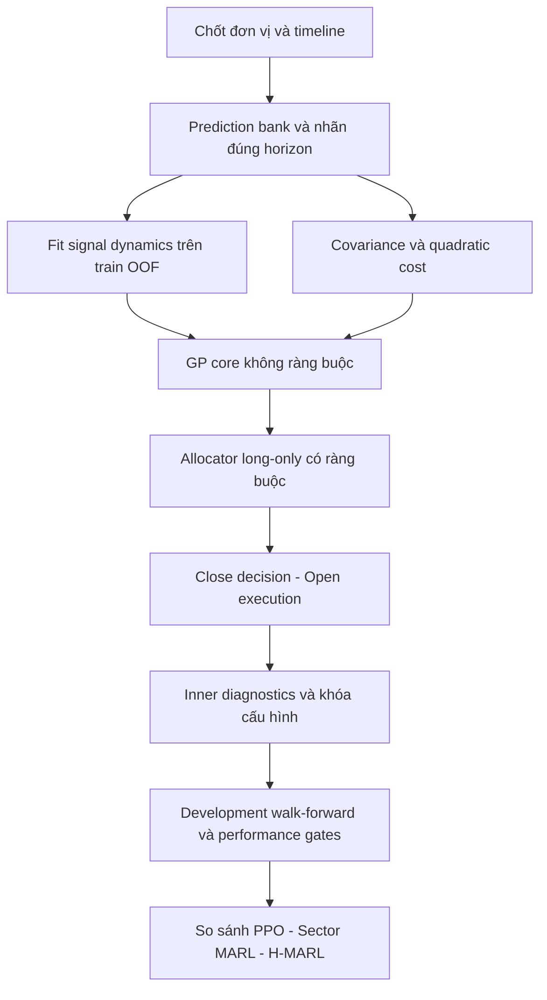

# QNT-013D — Các bước triển khai Gârleanu–Pedersen hoàn chỉnh

Ngày lập: **20/10/2026**. Owner A: dữ liệu, risk/cost, accounting và đánh giá. Owner B: dynamics, solver và adapter; hai bên review chéo.

**Cập nhật triển khai 20/10/2026:** đã có code GP temporary-cost reference, calibration/dynamics, constrained QP/MPC và runner. Xem [triển khai và trạng thái nghiệm thu](TRIEN_KHAI_GP.md), [contract/lệnh đang chạy được](GP_CONVENTIONS.md). Các mục bên dưới giữ vai trò kế hoạch gốc; chữ “dự kiến/chưa có” trong đặc tả ban đầu cần đối chiếu với hai tài liệu trạng thái này. Không tự đóng D8/D9 chỉ vì đã có code.

## 1. Phạm vi và thứ tự làm



Có ba sản phẩm cần phân biệt:

| Sản phẩm | Nội dung | Có thể gọi là gì? |
|---|---|---|
| `gp_reference` | Tái hiện mô hình tuyến tính/quadratic trong tọa độ holdings, tham số cố định, không constraints | Nghiệm GP trong các giả định đã chốt |
| `gp_constrained` | Điều chỉnh cho danh mục long-only, cash, cap và execution của đồ án | GP-inspired constrained allocator; không khẳng định còn nghiệm đóng của bài gốc |
| `gp_mpc` | Tối ưu nhiều bước có constraints và terminal value | Benchmark dynamic convex/MPC; chỉ gọi tối ưu cho bài toán được giải |

Bắt đầu temporary quadratic impact. Persistent impact cần thêm trạng thái và mô hình riêng, là giai đoạn sau. Không cần triển khai persistent impact để nghiệm thu bản temporary-cost đầu tiên; phải ghi rõ phạm vi.

## 2. Bước 1 — Chốt contract toán và kế toán

**Bàn giao:** `manual/GP_CONVENTIONS.md` và schema dữ liệu, trước khi viết solver.

| Đại lượng | Quy ước bắt buộc |
|---|---|
| Thời điểm quan sát | Close[t], chỉ dữ liệu đã có đến t |
| Khớp và NAV | Open[t+1], sau đó mark Close[t+1] |
| `risk_aversion` | Hệ số phạt rủi ro kinh tế, dương; không dùng PPO `gamma` |
| `discount_factor` | δ trong (0,1), theo một phiên; tách biệt risk aversion/PPO gamma |
| Forecast | Return thập phân, horizon và return basis có metadata |
| Risk | Covariance một phiên, không annualize bên trong solver |
| Cost | Ghi rõ tiền hay tỷ lệ NAV, theo holdings/notional/weights nào |
| Universe | Cùng ticker order của prediction/risk/liquidity banks |

Phải khai báo hai hệ tọa độ:

1. **Reference:** holdings x, thay đổi giá vượt risk-free và covariance theo cùng đơn vị. Nếu dùng giá điều chỉnh total return thì x là số đơn vị của chỉ số điều chỉnh, không gọi là cổ phiếu thật để tính ADV.
2. **Ứng dụng:** risky weights w và cash; notional dự kiến `NAV[t] * abs(delta_w)`. Mapping holdings → weights phải ghi phép đổi đơn vị và giả định NAV/giá cố định trong bước hoạch định.

Không lấy ma trận chi phí trong đơn vị shares nhân trực tiếp với vector weights. Risk aversion cũng cần đổi thang tương ứng, không sao chép cùng một số giữa hai hệ tọa độ.

GP reference giả định trạng thái holdings giữ nguyên giữa các lần giao dịch. Weight thực tế trôi theo giá và NAV. Bản weight-based dùng linear-quadratic approximation phải được đặt tên như vậy; không mặc định đồng nhất với nghiệm reference.

**Nghiệm thu contract:** một ví dụ 1 mã có phép đổi shares/notional/weights và chi phí tiền khớp nhau; xác định rõ overnight risk của vị thế cũ.

## 3. Bước 2 — Chuẩn bị predictor bank dành cho GP

Tái sử dụng `src/evaluation/prediction_bank.py`, `src/data/labels.py` và predictor lock. Chưa đổi predictor để làm GP trông tốt hơn.

Các trường tối thiểu của GP signal artifact:

```text
decision_date, available_at, ticker_order, factor_names
forecast_horizon, label_definition, return_basis
factor_vector, expected_step_return, factor_fit_id
fit_start, fit_end, maximum_label_end_used, bank_hash
```

### Không chia forecast h5 cho 5 một cách mặc định

Bank hiện dự báo `Open[t+1] -> Close[t+h]`, target là cross-sectional excess. GP cần expected payoff theo **mỗi bước hoạch định**. Chọn một trong hai cách và khóa trước thí nghiệm:

- **Cách ưu tiên ban đầu:** giữ forecast h5 đã khóa làm signal f[t], fit thêm mapping B từ f[t] sang nhãn một bước trên train OOF. Đây là một calibration layer mới, có artifact và ngân sách riêng; không gọi nó là predictor hoàn toàn không thay đổi.
- **Cách thay thế:** dựng/khóa predictor horizon 1, hoặc mô hình term structure cho các horizon và chuyển đổi nhất quán. Thay horizon phải mở protocol mới; không chọn bằng outer đã xem.

Return `Open[t+1] -> Close[t+1]` của lệnh mới khác return `Close[t] -> Close[t+1]` của vị thế đang giữ. Sau ngày đầu, các vị thế còn chịu overnight. Contract GP phải chọn rõ payoff model và phần gap không dự báo. Có thể thêm mapping gap riêng causal từ train, hoặc công khai giả định expected gap alpha bằng 0 nhưng vẫn đưa gap risk/PnL vào mô phỏng. Không dùng một nhãn intraday để ngầm coi là forecast toàn bộ holding interval.

Cross-sectional excess cho biết lựa chọn tương đối, không cho biết market premium để quyết định equity-vs-cash. Bản đầu giữ một chính sách cash/core được khai báo; nếu muốn market timing, cần predictor tuyệt đối/benchmark riêng được kiểm định.

**Nghiệm thu:** f[t] và B fit tại t không dùng label có endpoint sau cutoff. OOF pairs cho B chỉ dùng forecast được sinh ra trước outcome; purge theo endpoint, không chỉ theo ngày feature.

## 4. Bước 3 — Ước lượng signal dynamics

Module dự kiến: `src/models/signal_dynamics.py`.

Mô hình khởi đầu:

\[
 f_{t+1}=F f_t+\varepsilon_{t+1},\qquad
 E[r_{t+1}\mid f_t]=B f_t.
\]

Quy trình:

1. Chọn vector factors nhỏ, định danh rõ. Có thể dùng panel forecast N mã làm N factors; kiểm soát số tham số nếu VAR đầy đủ.
2. Fit train mean/scaler; lưu mean, scale và xử lý intercept riêng. Không fit scaler trên inner/outer.
3. Bắt đầu AR(1) diagonal hoặc VAR có ridge; đánh giá diagonal trước VAR đầy đủ.
4. Fit F chỉ với cặp ngày giao dịch liên tiếp và cùng định nghĩa factor. Không tạo cặp qua gap dữ liệu, ticker đổi hoặc model refit làm forecast đổi thang.
5. Fit B từ forecast OOF và nhãn một bước đã chốt. Nếu cùng fit nonlinear model và mapping trên cùng in-sample outputs, kết quả không thay thế được OOF calibration.
6. Kiểm tra spectral radius của F và condition number. Nếu không ổn định, reject fit hoặc áp shrinkage đã quy định, ghi cả tham số trước/sau; không âm thầm clip hệ số.
7. Với AR coefficient d trong (0,1), báo half-life `log(0.5)/log(d)`. d≤0 mô tả đảo dấu, d≥1 không có half-life mean-reverting thông thường; không ép thành một số đẹp.
8. Ghi forecast autocorrelation và predictive efficacy theo lag riêng. **Forecast bền không đồng nghĩa alpha còn dự báo đúng lâu**; cần đo quan hệ với outcome tương ứng trên train/inner.

Fit toàn bộ F/B trên train OOF chỉ được dùng cho inner kế tiếp. Nếu báo cáo portfolio trên chính train OOF, phải fit dynamics/calibration theo expanding prefix/nested block tại từng ngày hoặc gắn rõ đó là in-sample retrospective diagnostic. Forecast OOF không tự làm mọi lớp phía sau trở thành causal.

Family trong lock hiện chọn bằng inner IC, vì vậy historical OOF của family được chọn là một thí nghiệm offline; không được trình bày family choice đã biết ở các ngày OOF trước đó.

**Artifact:** `signal_dynamics.npz`, metadata JSON, residual diagnostics và lag/decay report. Có fit dates, scaler, F/B, residual covariance, readiness, source/data hashes.

## 5. Bước 4 — Risk covariance dùng đúng đơn vị

Tái sử dụng `src/risk/covariance.py`, nhưng phân biệt:

- Risk bank hiện tại chủ yếu ước lượng covariance return trailing.
- GP reference dùng conditional covariance của innovation quanh expected payoff. Hai đại lượng không tự bằng nhau.

Bản reference phải khai báo conditional-residual covariance hoặc một giả định đồng nhất được kiểm tra. Bản constrained có thể đối chứng sample/EWMA/Ledoit–Wolf hiện có, giữ PSD, ticker order và một lần annualization ở reporting.

Reference ban đầu dùng tham số cố định fit trên train. Nếu đưa covariance rolling vào rồi giải lại mỗi ngày, đó là **receding-horizon approximation**, không phải nghiệm stationary cố định. Lưu thời điểm cập nhật, readiness và tham số mỗi lần refit.

**Nghiệm thu:** symmetry, PSD/SPD theo yêu cầu solver, N=1, zero variance, missing data, scaling và causality. Mọi jitter/shrinkage đều ghi log.

## 6. Bước 5 — Xây quadratic cost model

Module dự kiến: `src/env/quadratic_cost.py`.

### 6.1 Chọn mô hình hoạch định

Ví dụ trong weight space, chi phí dự kiến theo tỷ lệ NAV:

\[
 c_{plan}(\Delta w)=\tfrac12\Delta w^\top\Lambda_w\Delta w.
\]

Chi phí tiền tương ứng là `NAV * c_plan`. Cần Lambda đối xứng PSD; reference solver thường cần SPD. Bắt đầu diagonal, chưa tự suy cross-impact từ tương quan giá.

### 6.2 Nguồn Lambda

- Có execution data: dùng orders/fills, mid-price, timestamps, ADV, volatility và loại bỏ price movement/commission khỏi impact theo mô hình đã chốt.
- Chỉ có OHLCV như hiện tại: Lambda là **scenario/proxy**, không đủ để tuyên bố đã hiệu chỉnh market impact thực tế.
- Có thể khớp quadratic surrogate với square-root impact trên **grid order-size định trước** từ train. Không coi tangent/local curvature của tổng cost là một quadratic toàn cục có cùng optimum.

Proxy diagonal có thể fit nonnegative least squares giữa chi phí tiền dự kiến và `NAV * 0.5 * lambda_i * delta_w_i^2`, với grid participation/NAV và trọng số fit đã khai báo. Báo approximation error theo order size; không fit bằng PnL inner/outer.

### 6.3 Chi phí hoạch định khác phí thực thu

Trong backtest, tiếp tục thu commission/slippage và impact theo `execute_cash_funded_trade()` trong `src/env/cost.py`. Không cộng thêm quadratic surrogate nếu nó chỉ xấp xỉ cùng phần impact đã thu. Commission/slippage 0.15% không được đổi thành 0 để làm GP thuận lợi.

Nếu planner bỏ linear commission thì đây là model mismatch cần ablation. Bản constrained/MPC có thể thêm penalty L1 cho commission; khi đó không còn pure closed-form GP. Ghi rõ spread/slippage hiện tại là baseline proxy và phần nào đã chứa impact để tránh tính trùng khi bổ sung eta.

**Artifact:** Lambda bank/scenario, units, NAV dependence, order-size domain, fit residuals, calibration dates và provenance. Cost scenario không được chọn lại theo outer.

## 7. Bước 6 — Viết GP reference solver trước

Module dự kiến: `src/evaluation/gp_allocator.py`. Dùng float64, `solve`/Cholesky thay vì gọi inverse trực tiếp.

### 7.1 Reference Bellman contract

Trong hệ tọa độ holdings đã chốt, đặt p là holdings trước giao dịch. Reference dùng:

\[
 V(p,f)=\max_x\left\{-\tfrac12(x-p)^\top\Lambda(x-p)
 +\delta\left[x^\top Bf-\tfrac\gamma2x^\top\Sigma x
 +E[V(x,Ff+\varepsilon)]\right]\right\}.
\]

Chốt đúng timing của discount trước khi dịch công thức. Với value form `V(p,f) = -0.5 p'Pp + p'Qf + terms independent of p`, có thể triển khai Bellman iteration:

```text
P = 0; Q = 0
repeat:
    M = Lambda + delta * (risk_aversion * Sigma + P)
    D = delta * (B + Q @ F)
    K_hold = solve(M, Lambda)
    K_signal = solve(M, D)
    P_new = Lambda - Lambda @ K_hold
    Q_new = Lambda @ K_signal
    kiểm tra residual tương đối; cập nhật P, Q
until converged

recompute M, D, K_hold, K_signal from final P, Q
x_star = K_hold @ p + K_signal @ f
rate = I - K_hold
aim = solve(rate, K_signal @ f)  # chỉ nếu conditioning cho phép
```

Đây là cách xây solver theo Bellman contract nêu trên; kiểm tra dấu, discount và thứ tự nhân bằng reference equations trước khi coi đã tái hiện bài báo. Q có shape `[assets,factors]`, P/M/Lambda/Sigma `[assets,assets]`. Luôn tính x_star trực tiếp khi aim không ổn định về số học; không đổi mô hình bằng cách clip aim.

Ghi iterations, relative Bellman residual, FOC residual, condition number và eigenvalue diagnostics; lỗi hội tụ không trả target tùy ý. Thêm numerical oracle finite-horizon/backward induction và case scalar. [Nguồn đối chiếu: Gârleanu–Pedersen (2013), equations 5–8 và Appendix](https://research-api.cbs.dk/ws/portalfiles/portal/60191441/lasse_heje_pedersen_et_al_dynamic_trading_acceptedmanuscript.pdf).

### 7.2 Các điều kiện nghiệm thu reference

- Dimensions và units đúng; terminal zero value cho finite-horizon oracle.
- x_star thỏa FOC và cách tính `p + rate @ (aim-p)` khi aim khả nghịch ổn định.
- Trường hợp Lambda tỷ lệ Sigma khớp scalar closed-form trong bài báo theo cùng convention.
- Chi phí tiến về 0 thì policy tiến về frictionless solution khi các ma trận/risk đủ điều kiện; không truyền Lambda=0 vào solver bắt buộc SPD rồi che lỗi bằng jitter lớn.
- Lambda lớn làm trade ít hơn trong case scalar chuẩn; không khẳng định từng phần tử của rate đa tài sản phải trong [0,1].
- Matrix rate không phải vector alpha để clip từng phần tử; off-diagonal có thể âm.
- Baseline scalar, synthetic impulse response và residuals phải đạt tolerance đã khóa trước khi nối env.

Các checklist kiểm thử này là **công việc cần làm khi triển khai**, chưa được thêm/chạy trong bước viết kế hoạch.

## 8. Bước 7 — Chuyển sang constrained portfolio của đồ án

Không chỉ lấy GP rate nhân vào target convex cũ: aim và speed phải sinh từ cùng bộ B/F/Sigma/Lambda. Replay target tape hiện có chỉ kiểm tra execution, chưa đủ nghiệm thu GP đầy đủ.

Đề xuất hai cấp:

### Cấp A: constrained Bellman step

Trong weight-based approximation đã định nghĩa riêng:

```text
minimize 0.5 * w' M w - w' (Lambda * current + D * f)
subject to constraints chung đã khai báo
```

M/D phải được suy ra cho **cùng objective**: total risk hay active tracking risk quanh core. Nếu dùng active weights a=w-core, budget, linear term và state p đều phải đổi theo; không giữ công thức total holdings rồi chỉ trừ core trong một penalty.

Một bước constrained dùng unconstrained continuation value chỉ là approximation của bài toán constrained nhiều kỳ. Nó cần được đặt tên `gp_constrained`, không tuyên bố exact constrained dynamic optimum. Euclidean clip/renormalize sau x_star cũng không tương đương giải QP này.

### Cấp B: constrained MPC

Sau khi Cấp A đạt nghiệm thu, giải chuỗi w[0:H] với future expected signals từ F, quadratic/L1 cost, risk và terminal value. Lấy action đầu rồi giải lại tại Close tiếp theo. Chốt terminal convention/discount/cost theo cùng objective; không dùng future forecasts thực nhận ở t+j làm perfect foresight.

Constraints chung tối thiểu: long-only, cash funding, per-asset cap, ADV participation, cùng risk/core policy. Record primal/dual residuals và feasibility. Chưa có dữ liệu cross-impact thì không tự thêm ma trận cross-impact đầy đủ.

### Chốt initial cash và tilt bounds trước

Danh mục khởi tạo cash 100% không thỏa lower stock bounds quanh 1/N. Không cưỡng ép fully invested trong đúng một ngày chỉ để solver feasible rồi so với baseline ramp 0.25.

Chọn trước một protocol:

1. Giữ cash start chung; hard constraints cho actual execution là long-only/cap/cash/participation, còn core/tilt có soft tracking penalty hoặc target envelope được xác định rõ. Báo exposure/ramp riêng và dùng control cùng constraints.
2. Hoặc tạo common funded initial portfolio cho mọi nhánh, tính đầy đủ phí khởi tạo rồi mới bắt đầu comparison; đây là protocol mới, không thay âm thầm kết quả cũ.

Target bounds và bounds trên actual holdings là hai khái niệm khác nhau. Nếu constraints thực sự infeasible, log và theo policy fallback đã khóa; không tự nới lower/cash bounds mà không ghi nhận.

## 9. Bước 8 — Nối vào TradingEnv một lần

Các điểm tích hợp:

- `src/evaluation/decision_data.py`: cung cấp causal factors/risk/cost/dynamics và global date indices.
- Adapter dự kiến `src/models/gp_adapter.py`: tạo Close proposal + provenance + diagnostics.
- `src/env/trading_env.py` / `src/env/rebalance.py`: thực thi proposal, giữ order hold và giới hạn cơ học.
- `src/env/cost.py`: thu phí thật, đối chiếu NAV/PnL.

Quy tắc:

1. GP đã tính trading speed thì không blend thêm action_alpha=0.25. Cần API “final Close execution proposal” rõ ràng; không giả vờ đó là policy target rồi cho qua smoothing lần hai.
2. Không nhân tiếp ER/asymmetric/cost-risk brake cũ trong benchmark GP đầu tiên.
3. Dollar participation caps và dữ liệu lựa chọn tốc độ lấy từ Close[t]. Không dùng Open[t+1] để refit aim/rate.
4. Open drift vẫn tạo chênh lệch giữa planned và filled weights. Log riêng projected Close proposal, Open holdings, fill, shortfall và giới hạn binding.
5. Quy tắc cancel/no-trade: dùng `PortfolioOrder.hold()` hoặc hold mask giữ lượng cổ phiếu, không trả current Close weights rồi gọi là hold.
6. Lệnh mua được giảm nếu thiếu cash sau phí; không tiêu NAV âm. Phần order không fill không được coi là đã đạt target.
7. Controller không đọc realized labels, future predictor fits hay outcome để chọn speed.

Nếu cần đặt no-trade band, participation cap hoặc risk emergency ngoài solver, chúng là overlay chung cho các nhánh liên quan. Báo overlay contribution riêng; GP chỉ tối ưu planning model, không tự bảo đảm tránh market gap.

**Log bắt buộc:** decision/execution date, factors, model IDs, aim, rate hoặc rate summary, unconstrained/proposed/filled weights, forecast payoff, risk, planned-vs-realized costs, cash, hold, caps, solver residuals/status, data readiness.

## 10. Bước 9 — Config, artifacts và khả năng tái lập

Config dự kiến `configs/gp_allocator.yaml`, tối thiểu:

```yaml
# ĐẶC TẢ DỰ KIẾN — chưa có loader/CLI thực thi.
version: gp-research-v1
enabled: false
model: gp_constrained
risk_objective: active_tracking
coordinate_system: nav_fraction_planning_approximation
signal:
  source: locked_prediction_bank
  step_mapping: train_oof_calibrated
  dynamics: diagonal_ar1
  fit_scope: expanding_train_only
cost:
  planner: quadratic_surrogate
  calibration_source: declared_ohlcv_scenario
  realized: existing_cash_funded_engine
  cross_impact: false
execution:
  applies_speed_once: true
  er_overlay: false
  asymmetric_overlay: false
evaluation:
  development_only: true
  allow_test: false
```

Trước khi chạy, bắt buộc bổ sung **giá trị cụ thể** cho risk_aversion, daily discount, regression regularization, training cutoffs/refit schedule, cost grid/NAV/scenario range, planning horizon, constraint/initialization policy, solver tolerances và fallback. Không đặt số “chuẩn” rồi mặc định đã calibrated.

Tách bank source protocol khỏi decision comparison protocol: protocol cũ đóng băng action_alpha=0.25. GP thay execution rule nên phải có protocol dẫn xuất/hash mới, dẫn chiếu predictor lock cũ; không sửa bank hay gán rằng đã giữ nguyên mọi execution assumption.

Artifact tối thiểu:

```text
manifest.json / resolved_config.yaml / decision_protocol.json
predictor_lock.json / signal_mapping.* / signal_dynamics.*
covariance_metadata.json / quadratic_cost_metadata.json
refit_schedule.csv / readiness.csv
daily_decisions.* / daily_returns.csv / portfolio_metrics.csv
solver_diagnostics.csv / cost_decomposition.csv
paired_comparison.csv / gate_report.json
```

Lưu source/data/config hashes, runtime/library versions, ticker/date order, seeds, refit state và last processed date. Resume phải khôi phục dynamics/risk/cost/controller state đúng; không chỉ nạp weights predictor.

## 11. Bước 10 — Inner pilot, rồi khóa cấu hình

Pilot đầu: một development fold đã định trước, train OOF + inner; không outer/test. Mục đích kiểm tra mechanics/model mismatch, không xác nhận alpha.

Các nhánh tối thiểu:

| Nhánh | Mục đích |
|---|---|
| Matched 1/N fixed | Đối chứng kinh tế |
| Convex hiện tại fixed | Benchmark triển khai sẵn |
| Same aim + fixed speed | Đo đóng góp aim khi speed cố định |
| Same aim + GP speed | Đo đóng góp speed với cùng aim |
| GP đầy đủ | Đo đóng góp dynamic model |
| GP không forecast alpha | Xem lợi ích đến từ risk/execution thay vì predictor |

Control ablation phải ghi rõ đã mất tối ưu joint model ở đâu. Same-aim controls dùng cùng nguồn aim causal/shadow state được định nghĩa trước, không vô tình tạo các aim khác nhau rồi gán mọi khác biệt cho speed.

Kiểm tra signal mapping MSE/calibration, decay/lag efficacy, impulse response, NAV/fees, alpha noise sensitivity, cash/risk exposure, cap/ADV binding, conditioning và solve latency. Phân biệt planning objective tốt với **realized net return** tốt.

Khóa config sau inner, gồm search budget và toàn bộ arm/hypothesis. Không chọn Lambda theo riêng Sharpe năm 2020 vì pilot hiện tại đã xem năm đó nhiều lần.

## 12. Bước 11 — Development walk-forward và performance gates

Runner dự kiến: `scripts/compare_gp_allocators.py`. Chưa viết/chưa có lệnh chạy trong repository.

1. Dùng lịch folds đã khai báo hoặc protocol dẫn xuất minh bạch. F/B/risk/cost fit chỉ trên thông tin hợp lệ trước cutoff.
2. Inner được dùng chọn trong budget; outer development đánh giá cấu hình đã khóa của fold. Refit qua inner_end được phép nếu protocol quy định trước; không refit bằng outer outcomes.
3. Giữ cùng prediction source, cost engine, dates/universe, constraints và initial conditions. Đồng bộ terminal tail/hold và horizon purge.
4. GP deterministic không cần chạy lại 5 seed chỉ để tạo 5 bản sao; báo randomness ở predictor/fit riêng. Nếu so RL, giữ 5 seed RL theo protocol, không coi các seed chung thị trường là mẫu thời gian độc lập.
5. Paired net active returns phải khớp ngày. Không nối các fold overlap thành một chuỗi independent giả; block bootstrap và multiple-testing correction theo family/hypotheses đã khóa.
6. Báo delta Sharpe, net excess, uncertainty, drawdown, turnover/cost decomposition, mean cash/exposure, forecast age và execution shortfall. Áp performance gates hiện có hoặc phiên bản mới được khóa trước.
7. Stress Lambda/scenario, realized impact eta, NAV, participation, missing data và regime; stress grid không trở thành một vòng chọn trên outer.
8. Dừng nếu hết search budget hoặc thất bại cơ học. Một nhánh không qua gate vẫn lưu kết quả; không hạ gate để promotion.

2024–2025 đã được khảo sát, các outer development cũng đã được đọc trong nghiên cứu trước. Kết quả mới trên chúng vẫn exploratory. Final holdout cần period có provenance chưa sử dụng và cấu hình khóa trước lần mở; không tự gọi một năm mới là độc lập nếu dữ liệu/nhãn của nó đã tham gia lựa chọn.

## 13. Bước 12 — Chỉ sau benchmark mới nối vào RL

GP là allocator đối chứng độc lập trước. Nếu hiệu quả ròng đủ bền:

- Dùng GP teacher targets trên train OOF cho behavior cloning, so thêm persistence baseline như thí nghiệm convex imitation hiện tại.
- Hoặc GP core + bounded residual từ actor, kiểm soát signal/risk budget rõ ràng.
- Hoặc cùng forecast cho GP/PPO/Sector MARL/H-MARL để đo đóng góp decision model.

Teacher outputs phải sinh causal qua cả dynamics/calibration/cost fits, không chỉ causal ở predictor. Không dùng GP target từ fit đã nhìn inner để huấn luyện actor trên quá khứ rồi gọi là OOF teacher.

Mỗi cách thêm learning objective/architecture là thí nghiệm riêng; giữ baseline GP và fixed controls. Không bật GP + ER + asymmetric + DSR đồng thời ở lần đo đóng góp đầu tiên.

## 14. Checklist và thứ tự bàn giao A/B

| Mục | Owner chính | Sản phẩm để review | Chặn bước sau nếu chưa đạt |
|---|---|---|---|
| D1 — Contract/timeline/units | A + B | GP_CONVENTIONS, ví dụ đơn vị và initial cash | Có |
| D2 — Step forecast mapping | B; A kiểm nhãn | Mapping artifact, purge và provenance | Có |
| D3 — Dynamics/decay | B | F/B fit, stability, lag efficacy | Có |
| D4 — Conditional risk và Lambda | A | Banks/scenarios, units, mismatch report | Có |
| D5 — GP reference | B; A review toán | Scalar oracle, Bellman/FOC residuals | Có |
| D6 — Constraints và execution | A + B | QP/MPC spec, NAV/funding/hold checks | Có |
| D7 — Inner pilot/config lock | A đánh giá, B runner | Learning/decision diagnostics, config hash | Có |
| D8 — Walk-forward/gates | A + B | Paired report, costs/uncertainty | Có trước promotion |
| D9 — RL teacher/residual | B; A review | Thí nghiệm riêng nếu D8 hỗ trợ | Không thuộc GP MVP |

**Hoàn thành triển khai temporary GP** khi D1–D8 có code, artifacts, các kiểm thử đã định nghĩa và báo cáo đúng phạm vi. **Đạt hiệu quả kinh tế** là điều kiện riêng: phải qua gate; hoàn thành phần mềm không tự chứng minh có alpha.

## 15. Những việc không được bỏ qua

- Không dùng `risk_aversion * variance / cost` thay solver.
- Không xem forecast autocorrelation là đủ để kết luận alpha decay.
- Không dùng forecast h5/5 như daily expected payoff nếu chưa có giả định và đối chứng.
- Không dùng future Open để chọn tốc độ tại Close.
- Không lấy shares-cost Lambda áp vào weights hoặc annualized covariance áp vào daily planning.
- Không thu phí quadratic surrogate lần nữa trên phần impact đã thu.
- Không clip matrix rate thành các alpha độc lập và vẫn gọi là GP.
- Không projection Euclidean/normalize rồi tuyên bố vẫn là constrained optimum.
- Không áp scalar alpha lần hai, không bỏ commission/ADV để tăng lợi thế GP.
- Không gọi train OOF causal nếu downstream F/B được fit bằng toàn bộ tương lai của khoảng báo cáo.
- Không ghi lệnh GP là chạy được trước khi runner/loader được triển khai.

## Tài liệu liên quan

- [Bốn cơ chế execution và kết quả ER/asymmetric](EXECUTION_ALPHA_THICH_NGHI.md).
- [QNT-013 và backlog QNT-013D](TICKET_CAI_THIEN_DINH_LUONG.md#qnt-013).
- [Prediction bank và nhãn giao dịch](PREDICTION_BANK_VA_NHAN_GIAO_DICH.md).
- [Khóa predictor và so sánh allocator](LOCK_PREDICTOR_VA_SO_SANH_ALLOCATOR.md).
- [Bắt chước convex targets và persistence control](BAT_CHUOC_CONVEX_TARGETS.md).
