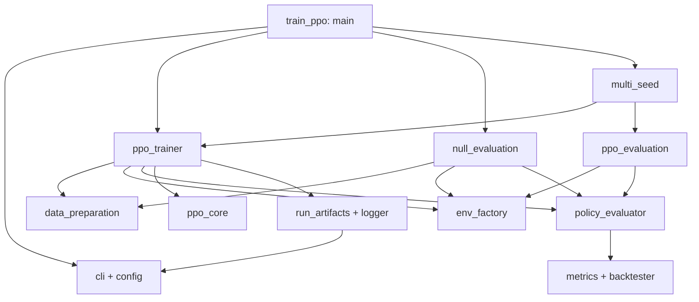

# Kiến trúc module huấn luyện và đánh giá PPO

**Cập nhật:** 18/10/2026. Mã được tách theo trách nhiệm từ `src/training/train_ppo.py`; các tham số, công thức, thứ tự log và format output được giữ khi di chuyển hàm.

## 1. Bản đồ module và phân công 70/30

| Module | Trách nhiệm | Owner / Reviewer |
|---|---|---|
| `src/training/train_ppo.py` | Entry point, chọn single/null/multi-seed, re-export API cũ | B / A |
| `src/training/cli.py` | Parser CLI dùng chung; giữ nguyên flags/defaults/help | B / A |
| `src/training/config.py` | Resolve CLI → training YAML → fallback, kiểm tra và snapshot cấu hình | B / A |
| `src/training/data_preparation.py` | Giá điều chỉnh, feature/scaler, split và căn ngày | A / B |
| `src/training/env_factory.py` | Tạo `TradingEnv` từ feature, giá, history và graph | A / B |
| `src/evaluation/policy_evaluator.py` | Inference, backtest policy, chẩn đoán weights, metric summary và 1/N | A / B |
| `src/evaluation/ppo_evaluation.py` | So sánh test period, bootstrap, CSV/daily returns và metadata | A / B |
| `src/training/ppo_trainer.py` | Vòng lặp PPO: setup model, rollout, GAE/update, validation và chọn checkpoint | B / A |
| `src/training/ppo_core.py` | Buffer, GAE, PPO loss, minibatch/microbatch và KL guard | B / A |
| `src/training/run_artifacts.py` | Manifest, hash, cấu hình thực tế và kiểm tra điều kiện resume | B / A |
| `src/training/logger.py` | Ghi TensorBoard và serialize checkpoint | B / A |
| `src/training/null_evaluation.py` | Null policy nhiều seed trên validation, không train | B / A |
| `src/training/multi_seed.py` | Chạy từng seed và tổng hợp numeric metrics/metadata | B / A |

Mã serialize checkpoint ở logger; quyết định chọn best/latest và trạng thái optimizer/scheduler/RNG vẫn thuộc trainer. Không tạo lại các phép tính `FinancialMetrics`/bootstrap đã có trong `src/evaluation/metrics.py`.

## 2. Hướng phụ thuộc



Các module triển khai không import ngược `train_ppo`. `multi_seed` nhận `train_fn` và `evaluate_fn`, cho phép tái sử dụng runner hoặc thay trainer mà không sửa vòng lặp seed.

Observation/graph/history-mask adapters tiếp tục thuộc `src/models/policy_adapter.py`. Factory chỉ tạo env; không có bản sao logic serialize observation tại đây.

## 3. Sử dụng và tương thích

Lệnh cũ tiếp tục dùng nguyên dạng:

```bash
python -m src.training.train_ppo --encoder gnn
```

Import cũ cũng được giữ, ví dụ:

```python
from src.training.train_ppo import create_env, evaluate_policy, policy_weight_summary
```

Mã mới nên import trực tiếp module sở hữu hàm:

```python
from src.training.data_preparation import close_price_matrix, open_price_matrix
from src.training.env_factory import create_env
from src.evaluation.policy_evaluator import evaluate_policy, metric_summary, policy_weight_summary
```

Các script IC/tilt/robustness đã chuyển sang import trực tiếp. Entry point vẫn chuyển các callable `train`/`evaluate_test` sang runner, giữ điểm thay thế đã dùng trong kiểm thử và code điều phối cũ.

## 4. Bất biến khi refactor

- Không thay đổi tên/cách resolve CLI, sampler, GAE, loss, KL guard, selection, timeline/cost hay baseline.
- Giữ tên file, cột/thứ tự CSV và TensorBoard tag/step. Runtime, wall time, source hash và đường dẫn artifact phụ thuộc lần chạy; chúng được đối chiếu riêng với kết quả tài chính.
- Resume tiếp tục kiểm tra source/config/data hash. Checkpoint của phiên bản trước refactor không đáp ứng điều kiện “cùng source”; không bỏ kiểm tra hash để ép resume.
- `ppo_trainer` giữ vòng lặp và closure metadata để bảo toàn thứ tự cập nhật và snapshot. Entry point gọn không có nghĩa mọi module buộc cùng một giới hạn số dòng.

Kiểm thử ranh giới module: `tests/integration/test_training_modules.py`. Kiểm thử train/resume/đa seed thật: `tests/integration/test_training_artifacts.py`.

## 5. Kết quả đối chiếu ngày 18/10/2026

- Trước refactor: **210 passed**. Sau refactor và ba kiểm thử ranh giới mới: **213 passed**.
- Lệnh: `OMP_NUM_THREADS=1 MKL_NUM_THREADS=1 .venv/bin/python -m pytest -q`.
- `--help` trước/sau khớp toàn bộ nội dung; 23 hàm di chuyển giữ nguyên AST. Main chuyển nhánh đa seed sang runner với callback.
- So sánh bản nguồn trước refactor và bản module trên cùng synthetic fixture/seed, một update cho mỗi cấu hình: MLP, GRU, LSTM, GNN+GCN và GNN+GAT.
- Cả năm cấu hình: model weights khớp chính xác; `metrics.csv` và `daily_returns.csv` giống từng byte; training log khớp các cột ngoài thời gian; TensorBoard scalar ngoài `Time/*` khớp tag/step/value, bao gồm cùng vị trí NaN.
- Runtime và wall time là phép đo của từng lần chạy; source hash phản ánh cấu trúc source mới. Đối chiếu trên dữ liệu tổng hợp xác nhận refactor, không phải một thí nghiệm mới về lợi thế đầu tư.

Bộ kiểm thử vẫn phát ra cảnh báo có sẵn về `torch.jit.script` và trường hợp epoch 0 được chọn. Refactor không thay chính sách fallback/checkpoint.
