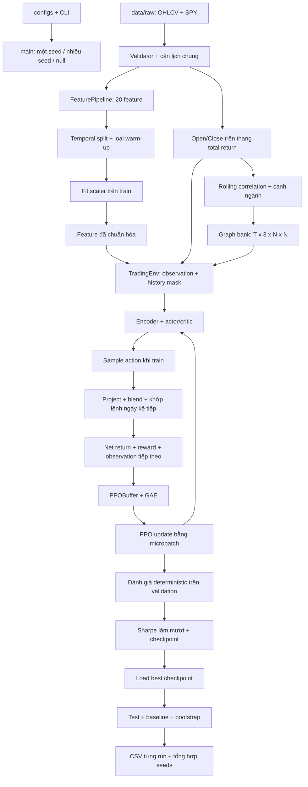
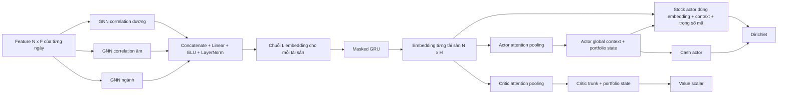
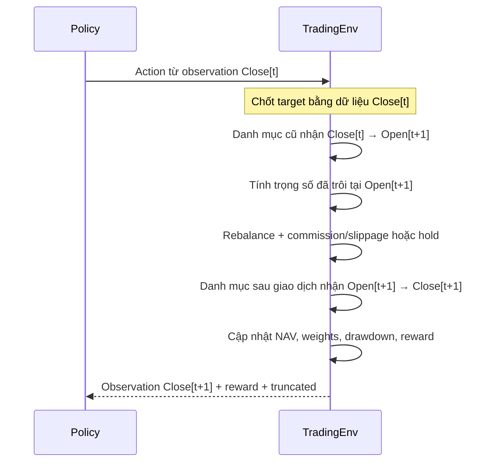

# Luồng và cơ chế chạy hiện tại của hệ thống

> **Cập nhật 19/10/2026:** evaluation mặc định đã chuyển sang validation; test cần `--evaluation-scope test`. Accounting nội bộ dùng float64, observation policy vẫn float32. Helper GAT entropy tính theo node/head và chưa bật trong PPO loss. Các ví dụ test ở dưới cần chọn scope test tường minh; xem [bản sửa](SUA_LOI_KIEM_CHUNG_2026_10_19.md).


**Ngày mô tả:** 14/10/2026.  
**Nguồn:** mã trong `src/`, các script và cấu hình tại thời điểm viết; đã bao gồm thay đổi history mask tường minh.  
**Entry point chính:** `python -m src.training.train_ppo`.

**Cập nhật cấu hình 18/10/2026:** tham số vòng lặp train, early stopping, chọn checkpoint, evaluation và runtime chuyển sang `configs/training.yaml`; CLI vẫn ghi đè. Các mô tả/thực nghiệm khác trong tài liệu giữ mốc ngày mô tả ở trên.

**Cập nhật module 18/10/2026:** `train_ppo.py` là entry point tương thích; logic hiện thuộc các module data/env/evaluation/trainer/runner. Xem [bản đồ module và phân công A/B](KIEN_TRUC_MODULE_PPO.md). Các tham chiếu tới hàm ở entry point vẫn dùng được qua re-export.

Tài liệu mô tả cách chương trình đang chạy. Với một kết quả đã lưu, dùng `manifest.json` và metadata checkpoint của run đó để biết phiên bản mã, cấu hình và dữ liệu đã thực sự được sử dụng. Run được khởi động trước sửa masking có thể dùng cơ chế cũ.

**Sprint 5 ngày 18/10/2026:** đã bổ sung protocol train/inner/outer development, validation-only, checkpoint learning gate và IC/linear baseline theo fold. Xem [báo cáo nghiệm thu](NGHIEM_THU_SPRINT_5.md) cho luồng và artifact mới; default CLI không dùng protocol vẫn giữ cách đánh giá lịch sử trước đó.

## Mục lục

1. [Phạm vi triển khai](#1-phạm-vi-triển-khai)
2. [Sơ đồ tổng thể](#2-sơ-đồ-tổng-thể)
3. [Cấu hình và kích thước dữ liệu](#3-cấu-hình-và-kích-thước-dữ-liệu)
4. [Đọc dữ liệu và kiểm tra chất lượng](#4-đọc-dữ-liệu-và-kiểm-tra-chất-lượng)
5. [Tính feature, warm-up và chuẩn hóa](#5-tính-feature-warm-up-và-chuẩn-hóa)
6. [Giá dùng trong mô phỏng](#6-giá-dùng-trong-mô-phỏng)
7. [Đồ thị động đa quan hệ](#7-đồ-thị-động-đa-quan-hệ)
8. [Observation và masking](#8-observation-và-masking)
9. [Actor–critic và phân phối hành động](#9-actorcritic-và-phân-phối-hành-động)
10. [Một bước giao dịch](#10-một-bước-giao-dịch)
11. [Reward](#11-reward)
12. [Một epoch huấn luyện](#12-một-epoch-huấn-luyện)
13. [Buffer, GAE và cập nhật PPO](#13-buffer-gae-và-cập-nhật-ppo)
14. [Cache và cơ chế giảm chi phí tính toán](#14-cache-và-cơ-chế-giảm-chi-phí-tính-toán)
15. [Validation và chọn checkpoint](#15-validation-và-chọn-checkpoint)
16. [Test, baseline và metrics](#16-test-baseline-và-metrics)
17. [Chạy nhiều seed và đọc log](#17-chạy-nhiều-seed-và-đọc-log)
18. [Artifact, ngắt chạy và resume](#18-artifact-ngắt-chạy-và-resume)
19. [Inference và MARL wrapper](#19-inference-và-marl-wrapper)
20. [Các luồng nghiên cứu bổ sung](#20-các-luồng-nghiên-cứu-bổ-sung)
21. [Giới hạn của kết quả và bản đồ mã nguồn](#21-giới-hạn-của-kết-quả-và-bản-đồ-mã-nguồn)

## 1. Phạm vi triển khai

Luồng chính đang hoạt động là **PPO một agent phân bổ toàn danh mục**:

- Một model tạo trọng số cho 24 cổ phiếu và một phần tiền mặt.
- `TradingEnv` mô phỏng giao dịch, phí, NAV và reward.
- `--encoder gnn` dùng GAT/GCN đa quan hệ kết hợp GRU theo thời gian.
- Train dùng các cửa sổ ngẫu nhiên trong giai đoạn train; validation dùng toàn kỳ để chọn checkpoint; checkpoint được đánh giá trên giai đoạn test đã cấu hình.

Tên đề tài là H-MARL-GNN. Repository có `MultiAgentTradingEnv`, phân nhóm ngành và adapter, nhưng `train_ppo.py` hiện sử dụng `TradingEnv` và một actor–critic. Luồng này chưa huấn luyện một high-level allocator cùng nhiều policy ngành độc lập.

## 2. Sơ đồ tổng thể



Graph và feature được tính trước cho toàn lịch dữ liệu. Khi lấy observation hoặc minibatch, chỉ dùng history kết thúc ở ngày ra quyết định. Scaler chỉ fit trên phần train đủ warm-up.

## 3. Cấu hình và kích thước dữ liệu

### 3.1. Nguồn cấu hình

| Nguồn | Vai trò |
|---|---|
| `configs/assets.yaml` | Danh sách cổ phiếu, SPY, ngành và nhóm agent |
| `configs/env.yaml` | Vốn, commission/slippage, trần vị thế, lookback, reward và lãi tiền mặt |
| `configs/model.yaml` | GNN, learning rate, gamma, KL, clipping, entropy, critic và Dirichlet κ |
| `configs/training.yaml` | Epochs, PPO iterations, rollout/minibatch, early stopping, chọn checkpoint, evaluation và runtime |
| CLI | Ghi đè các tham số được parser hỗ trợ; chọn seed, encoder, cửa sổ, số update và output |
| `configs/tilt_robustness_gate.yaml` | Chiến lược tilt và cổng đánh giá riêng của script robustness |

`--encoder` mặc định là `gru`. Khi chọn `gnn`, kiến trúc mặc định trong YAML là GAT.

Một số khóa YAML là mô tả: luồng train luôn gọi PPO; timeline hiện được viết cố định là Close[t] → Open[t+1] → Close[t+1]. `gnn.in_channels` được thay bằng số feature thật trong tensor. Dropout policy được ép về 0 để log-prob nhất quán, dù YAML có `gnn.dropout: 0.2`.

### 3.2. Tham số đang dùng

| Tham số | Mặc định CLI/YAML | Cấu hình GAT nhỏ trong lệnh 5 seed |
|---|---:|---:|
| Cổ phiếu giao dịch `N` | 24 | 24 |
| Feature `F` | 20 | 20 |
| Lookback `L` | 20 | 10 |
| Hidden GRU/trunk | 128 | 64 |
| GNN hidden mỗi head | 64 | 16 |
| GAT heads | 4 | 2 |
| GNN output | 32 | 16 |
| Outer epochs / updates tối đa | 50 | 20 |
| Cửa sổ mỗi update | 32 | 8 |
| Độ dài cửa sổ | 126–252 phiên | 126–252 phiên |
| Lượt PPO trên một buffer | 10 | 3 |
| Effective minibatch | 256 | 256 |
| Microbatch GNN trên CPU | 16 | 16 |
| CPU threads | 4 | 4 |
| `action_alpha` | 0.25 | 0.25 |
| `reward_baseline` | `equal_weight` | `equal_weight` |
| Reward scale / beta | 100 / 1 | 100 / 1 |
| Learning rate / gamma / GAE λ | 0.0003 / 0.95 / 0.95 | Như mặc định nếu không ghi đè |
| Policy clip / target KL | 0.2 / 0.03 | Như mặc định |
| Entropy coef / value loss coef | 0.01 / 0.5 | Như mặc định |
| Value clipping | Tắt (`null`) | Tắt |
| Dirichlet κ | 200 | 200 |
| Selection window / margin | 5 / 0 | 5 / 0 |
| `min_epochs` / patience | 10 / 10 | 5 / 5 |

Đối chiếu tham số thật bằng manifest của từng run; sửa YAML có thể thay giá trị của các cờ để mặc định `None`. Với tham số run, ưu tiên là CLI → `training.yaml` → mặc định dự phòng; `batch_size` lấy từ `training.yaml`. Các giá trị auto được lưu sau khi resolve trong `training_config.json` và `resolved_training_config` của manifest/checkpoint; `training_config_inputs` giữ đầu vào trước auto để đối chiếu khi resume.

### 3.3. Kích thước quan trọng

| Đối tượng | Shape |
|---|---|
| Feature tensor toàn lịch | `[T,N,F]` |
| Observation history | `[L,N,F]` |
| History mask | `[L]` |
| Graph bank | `[T,R,N,N]`, `R=3` |
| Graph history | `[L,R,N,N]` |
| Stock weights trong observation | `[N]` |
| Cash ratio trong observation | `[1]` |
| Action policy | `[N+1]` |
| Observation vector trong buffer | `[L×N×F + N + 1]` |
| RNN observation minibatch sau unflatten | `[B,L,N,F]` |

Với 24 mã và 20 feature, observation vector có **4.825 chiều** khi lookback 10, **9.625 chiều** khi lookback 20. Mask và graph được truyền riêng; chúng không cộng vào chiều vector này.

## 4. Đọc dữ liệu và kiểm tra chất lượng

`prepare_data()` gọi `FeaturePipeline.run_from_raw()`:

1. Đọc danh sách được phép từ `assets.yaml`: 24 mã và SPY.
2. Đọc đúng các file Parquet tương ứng trong `data/raw/`.
3. Gọi `DataValidator` trước khi align và trước khi tính feature.
4. Dùng `CalendarAligner(method="intersection")` lấy các ngày có mặt ở tất cả chuỗi cần dùng.
5. Tạo DataFrame theo ngày tăng dần, tính feature rồi đóng gói tensor.

Các kiểm tra gồm dữ liệu không rỗng, đủ OHLCV, ngày không trùng, giá hữu hạn/dương, volume không âm và High/Low phù hợp Open/Close. `MarketDataTensor.validate()` còn kiểm tra shape, tên ticker/feature, ngày và NaN/Inf.

SPY nằm ngoài tensor/action giao dịch, được dùng tính feature tham chiếu. Tensor giao dịch có thứ tự ticker ổn định; đường build mặc định chuẩn hóa mã sang chữ hoa và sắp xếp. Giá, graph và model phải dùng cùng thứ tự này. Không lấy thứ tự trong YAML để đoán thứ tự action; đọc `tickers` trong tensor/checkpoint.

## 5. Tính feature, warm-up và chuẩn hóa

### 5.1. Danh sách 20 feature

Feature mặc định được tính trên OHLCV đã căn lịch, với `price_col="close"` của pipeline.

| Nhóm | Feature | Cơ chế hiện tại |
|---|---|---|
| Cơ bản | `return` | Log return `ln(Close[t]/Close[t−1])` |
| Cơ bản | `volatility_20d` | Sample std 20 phiên của feature `return`, không năm hóa |
| Cơ bản | `rsi_14` | Wilder RSI 14; pipeline chia 100 để về thang 0–1 |
| Cơ bản | `macd` | Chênh lệch EMA 12 và EMA 26 |
| Cơ bản | `macd_signal` | EMA 9 của MACD |
| Cơ bản | `volume_norm` | Z-score rolling 20 phiên của `ln(1+Volume)` |
| Tương đối | `xs_rank_ret_20d` | Percentile rank cắt ngang của return 20 phiên |
| Tương đối | `xs_rank_ret_60d` | Percentile rank cắt ngang của return 60 phiên |
| Tương đối | `excess_ret_20d` | Return 20 phiên trừ return SPY; nếu thiếu benchmark trong API tổng hợp thì dùng trung bình rổ |
| Tương đối | `beta_spy_60d` | Rolling covariance của log return mã/SPY chia variance SPY, cửa sổ 60 |
| Momentum | `ret_5d` | `Close[t]/Close[t−5] − 1` |
| Momentum | `ret_20d` | `Close[t]/Close[t−20] − 1` |
| Momentum | `ret_60d` | `Close[t]/Close[t−60] − 1` |
| Momentum | `mom_12_1` | `Close[t−21]/Close[t−252] − 1` |
| Momentum | `dist_52w_high` | `Close[t]/max(Close trong 252 phiên) − 1` |
| Rủi ro | `vol_60d` | Sample std 60 phiên của simple return |
| Rủi ro | `vol_ratio` | Std simple return 20 phiên / std 60 phiên |
| Rủi ro | `parkinson_vol_20d` | Căn trung bình rolling của `ln(High/Low)² / (4 ln 2)` |
| Rủi ro | `downside_vol_20d` | Căn trung bình rolling của `min(simple_return,0)²`, gồm ngày dương với đóng góp 0 |
| Rủi ro | `atr_14_close` | Trung bình true range 14 phiên chia Close |

`volatility_20d` dùng log return, còn mẫu số/tử số của `vol_ratio` dùng simple return trong module risk. Không nên coi hai chỉ báo 20 phiên này là cùng một phép tính.

### 5.2. Warm-up

Pipeline đánh dấu **252 phiên đầu** là warm-up vì `mom_12_1` cần lịch sử một năm. Feature chưa đủ lịch sử có thể được điền giá trị hữu hạn, nhưng những phiên này bị loại khỏi tập train dùng để fit/học.

PPO bỏ thêm `L−1` phiên đầu phần train đủ warm-up, để cửa sổ history đầu tiên cũng đủ feature đã warm-up. Với bộ raw đã dùng gần đây:

- Lookback 20: train thực tế bắt đầu 2016-02-01, 1.492 phiên.
- Lookback 10: train thực tế bắt đầu 2016-01-15, 1.502 phiên.

Đây là số của bộ dữ liệu đã quan sát; thay lịch raw sẽ thay ngày và số phiên. Có thể cung cấp dữ liệu trước 2015 để giữ ngày bắt đầu train mong muốn sau warm-up.

### 5.3. Temporal split và scaler

Các mốc mặc định:

- Train đến 2021-12-31, sau khi loại warm-up/lookback chưa đủ.
- Validation thuộc 2022–2023.
- Test lịch sử từ 2024, hiện dữ liệu đến cuối 2025.

`MarketFeatureScaler` fit trên train thực tế. Với mỗi feature, mean/std được gộp qua cả ngày và tài sản; không fit riêng một scaler cho từng mã. Transform dùng `(x−mean)/(std+eps)`, sau đó clip mặc định vào `[-10,10]`.

Cùng scaler được dùng cho train, validation, test và tensor lịch sử đầy đủ. Validation/test được nhìn lại các ngày trước ranh giới split để có history; scaler vẫn giữ thống kê train.

## 6. Giá dùng trong mô phỏng

Feature tensor là đầu vào học. Env nhận riêng hai ma trận giá Open/Close `[T,N]` để tính giao dịch và lợi nhuận.

`open_price_matrix()` / `close_price_matrix()` căn đúng lịch và dùng hệ số:

$$q_{i,t}=\frac{AdjClose_{i,t}}{Close_{i,t}}$$

$$Open^*_{i,t}=Open_{i,t}q_{i,t},\qquad Close^*_{i,t}=Close_{i,t}q_{i,t}$$

Env dùng các giá `*` này để mô phỏng trên thang total return, với diễn giải cổ tức được tái đầu tư. Trong một ngày, dùng cùng hệ số cho Open/Close giữ tỷ lệ giá trong phiên. Code không có một luồng tiền cổ tức riêng hay sổ lệnh broker thực tế.

Nếu nguồn thiếu Adj Close, helper dùng giá chưa điều chỉnh và phát cảnh báo. Vì vậy cơ sở return của một run còn phụ thuộc schema raw. Pipeline feature mặc định vẫn tính trên cột Close; không mặc nhiên coi mọi feature là feature total return.

## 7. Đồ thị động đa quan hệ

### 7.1. Graph của ngày t

Khi encoder là GNN:

1. Dùng `Close*` tạo simple close-to-close return.
2. `compute_rolling_correlation()` tính Pearson correlation rolling, mặc định 60 phiên.
3. Ma trận tại ngày t chỉ dùng return đến t; không dùng centered window hoặc shift tương lai.
4. `generate_correlation_edges()` chọn cạnh.
5. `MultiRelationGraphBuilder` tách dấu tương quan và thêm quan hệ ngành.
6. `build_dynamic_graph_sequence()` ghi vào bank theo cùng lịch feature.

### 7.2. Lọc cạnh

| Chế độ | Cách chọn |
|---|---|
| `knn` — mặc định | Mỗi node chọn tối đa k hàng xóm có **trị tuyệt đối correlation** lớn nhất; k hiện là 6 |
| `threshold` | Giữ cặp khác node khi `abs(corr) ≥ threshold` |
| `dynamic_threshold` | Ngưỡng theo mean + alpha × std của `abs(corr)` ngoài đường chéo |

k-NN có thể giữ tương quan âm. Nó sinh cạnh có hướng theo lựa chọn của từng node; chọn i→j không bắt buộc j→i cũng được chọn. Số cạnh thực tế có thể thấp hơn N×k khi correlation chưa có đủ dữ liệu hoặc trọng số bằng 0 bị loại khi tách quan hệ.

### 7.3. Ba kênh R

| Index R | Quan hệ | Trọng số |
|---:|---|---|
| 0 | `correlation_positive` | Correlation dương |
| 1 | `correlation_negative` | Độ lớn của correlation âm |
| 2 | `sector` | Cạnh giữa các mã cùng ngành, trọng số 1 |

Các trọng số đưa vào encoder đều không âm. Dấu được lưu bằng loại quan hệ. Cạnh ngành và cạnh correlation trùng cặp node vẫn ở hai kênh riêng.

`adjacency` và `edge_mask` có shape `[T,3,N,N]`. Builder không tạo self-loop; lớp PyG xử lý self-loop bên trong encoder. `edge_mask` chỉ sự tồn tại cạnh, không phải history mask.

## 8. Observation và masking

### 8.1. Observation ở Close[t]

| Khóa | Nội dung |
|---|---|
| `market_state` | Feature ngày t `[N,F]` |
| `market_history` | History kết thúc ở t `[L,N,F]` |
| `history_mask` | `[L]`, True cho ngày thật, False cho left-padding |
| `portfolio_weights` | Trọng số cổ phiếu được đánh dấu ở Close[t] `[N]` |
| `cash_ratio` | Trọng số tiền mặt `[1]` |
| `graph_adjacency_history` | Graph từng ngày trong history `[L,3,N,N]`, khi bật GNN |
| `graph_edge_mask_history` | Mask cạnh tương ứng, khi bật GNN |

Env kiểm tra ngày của đoạn `market_tensor` khớp đoạn trong `history_tensor`. Train, validation và test dùng cùng quy ước chỉ số ngày toàn lịch cho history và graph.

### 8.2. Ba loại mask/availability khác nhau

| Cơ chế | Mục đích |
|---|---|
| `feature_ready` / warm-up | Loại phiên chưa đủ lịch sử feature khỏi fit/train |
| `history_mask` | Bỏ timestep giả do left-padding |
| `graph_edge_mask_history` | Phân biệt cạnh tồn tại với cạnh vắng |

Ngày thật có feature toàn số 0 vẫn có `history_mask=True`. Warm-up là dữ liệu của ngày thật, nên không được tự diễn giải thành left-padding.

### 8.3. Đường truyền mask

```text
TradingEnv._get_obs()
  → history_mask_from_obs()
  → model.act(..., history_mask=...)
  → buffer.store(..., history_mask=...)
  → buffer.get()["history_mask"]
  → PPOUpdater lấy mask của microbatch
  → model.evaluate(..., history_mask=...)
```

Bootstrap value, diagnostics và inference adapter cũng truyền mask. Mask được lưu riêng dưới dạng bool; vector observation giữ nguyên kích thước. Serializer đưa phần bị mask về 0.

GRU/LSTM và GRU trong GNN dùng chung `masked_recurrent_hidden()`:

1. History đầy đủ: chạy RNN trực tiếp.
2. Có padding: gom timestep hợp lệ lên đầu, giữ thứ tự ban đầu.
3. Pack theo số timestep thật rồi chạy RNN.
4. History không có timestep hợp lệ: hidden state bằng 0.

Lời gọi model legacy không cấp mask coi history là đầy đủ. Checkpoint mới ghi `history_mask_convention`; `CheckpointPolicy` yêu cầu mask cho checkpoint có trường này.

## 9. Actor–critic và phân phối hành động

### 9.1. Các lựa chọn encoder

| CLI | Xử lý thị trường |
|---|---|
| `mlp` | Vector history phẳng + trạng thái danh mục qua các trunk MLP riêng |
| `gru` | Unflatten history, mỗi ngày flatten N×F; GRU chạy dọc thời gian |
| `lstm` | Như GRU nhưng dùng LSTM |
| `gnn` | Ba encoder graph theo ngày, fusion, GRU riêng theo chuỗi của từng tài sản |

GRU/LSTM độc lập dùng input `[B,L,N×F]`. Hidden cuối được nối với stock weights và cash, rồi đi qua actor/critic FC riêng. RNN representation được chia sẻ.

### 9.2. GAT/GCN + GRU



Mỗi quan hệ có một encoder với tham số riêng. GAT dùng hai lớp `GATv2Conv`, multi-head ở lớp đầu, residual và LayerNorm; edge weight đi vào attention bằng `edge_attr` với `edge_dim=1`. GCN dùng hai lớp `GCNConv` và LayerNorm.

Fusion nối ba embedding rồi nén về `gnn_out_channels`. GRU nhận chuỗi embedding của **từng mã** trên mọi ngày hợp lệ trong lookback. Sau GRU, vẫn giữ `[B,N,H]` để stock actor sử dụng thông tin riêng từng tài sản.

Actor và critic có pooling/trunk riêng, nhưng chia sẻ GNN/fusion/GRU. Cả actor loss và value loss có thể cập nhật shared encoder.

Dropout của policy bằng 0. Hàm entropy regularization của graph attention có trong module GAT, nhưng updater chính hiện cộng **entropy của Dirichlet action**, không cộng graph-attention entropy loss.

### 9.3. Dirichlet

Đặt `K=N+1`. Với κ cố định, mạng tạo score chuẩn hóa:

$$p_i=softmax(logits)_i$$

$$\alpha_i=1+(\kappa-K)p_i$$

$$a\sim Dirichlet(\alpha),\qquad E[a_i]=\frac{\alpha_i}{\kappa}$$

`softmax(logits)` là thành phần để tạo concentration; mean action thật còn có phần sàn `1/κ`. Với N=24, K=25, κ=200 và score đều, mỗi concentration bằng 8, mean action bằng 4%, gồm cả cash.

- Train: dùng `distribution.sample()` để khám phá.
- Validation/test: dùng `distribution.mean` để đánh giá deterministic.
- Khi κ được cấu hình, head cuối khởi tạo gần 0 với gain 0.01, nên policy ban đầu gần đều.
- Nếu κ không được cấu hình, concentration là `softplus(output)+1`, clamp tối đa 100.

Entropy Dirichlet là differential entropy và có thể âm. Entropy ít đổi khi κ cố định không đủ để kết luận policy không học; cần đọc thêm mean weights, validation và update statistics.

## 10. Một bước giao dịch

### 10.1. Timeline



Các biến giá ở phần tiếp theo là Open*/Close* đã điều chỉnh khi có Adj Close.

### 10.2. Target và blend

`project_action()` thực hiện:

1. Kiểm tra action `[N+1]` hữu hạn.
2. Chặn trọng số âm và chuẩn hóa tổng 1; vector không có phần dương chuyển về cash.
3. Cap từng cổ phiếu ở `max_asset_weight`, mặc định 20%; phần vượt trần chuyển sang cash.
4. Blend bằng trọng số hiện tại ở Close[t]:

$$w^{blend}=(1-\eta)w^{close}_t+\eta w^{policy},\qquad \eta=action\_alpha$$

5. Project/cap lại blended target.

Target được chốt trước overnight gap. Sau đó phí được tính bằng chênh lệch target này với **trọng số đã trôi đến Open[t+1]**. Policy không nhìn giá Open tương lai để quyết định target.

Reset bắt đầu với 100% cash. Với alpha 0.25, một target cash 4% sẽ có blended cash khoảng 76% ở lệnh đầu; các lệnh sau tiếp tục tiến vào danh mục. Matched baseline dùng cùng cơ chế này.

### 10.3. NAV, return và phí

Đặt `V_t` là NAV ở Close[t], `r_on` là return danh mục cũ qua đêm, `r_in` là return danh mục sau khớp lệnh trong phiên:

$$V_{open}=V_t(1+r_{on})$$

$$turnover=\sum_{i=1}^{N}|w^{target}_i-w^{open}_i|$$

$$cost\_rate=(fee+slippage)\times turnover$$

$$TC=V_{open}\times cost\_rate$$

$$V_{t+1}=(V_{open}-TC)(1+r_{in})$$

$$r_{net}=V_{t+1}/V_t-1$$

Cash không được tính thêm như một chân turnover. Với fee 0.10% và slippage 0.05%, mua từ toàn cash sang toàn cổ phiếu có turnover khoảng 1 và phí khoảng 0.15% NAV tại Open.

Lãi cash một ngày là `rf_annual/252`. Env chia thành hai phân kỳ với `sqrt(1+rf_daily)−1`, để compound hai phân kỳ bằng một ngày cash yield.

Sau phiên, weights trôi được đánh dấu ở Close[t+1], cùng thời điểm với feature observation mới. Một episode T ngày có **T−1 bước**, trả `terminated=False`, `truncated=True` khi hết đoạn dữ liệu.

### 10.4. Hold

`PortfolioOrder.hold()` bỏ rebalance và phí; danh mục tiếp tục trôi qua đêm/trong phiên. Trả lại weights Close[t] như một vector action vẫn là một lệnh rebalance, vì weights có thể đã trôi trước Open[t+1].

Trần vị thế áp dụng khi rebalance. Hold không tự bán vì một mã tăng giá khiến tỷ trọng vượt trần. Buy & Hold khớp đầy đủ target ở lệnh đầu với alpha riêng bằng 1, rồi dùng hold.

## 11. Reward

Khi bật `reward_baseline=equal_weight`, baseline của reward là:

$$b_t=\frac{1}{N}\sum_i\left(\frac{Close^*_{i,t+1}}{Close^*_{i,t}}-1\right)$$

Đây là **trung bình return close-to-close của cổ phiếu**, không phải một backtest matched baseline có cash, blend và phí. Khi chọn `none`, `b_t=0`.

Đặt `c_t=TC/V_t`. Env truyền vào `RewardEngine` hai đại lượng `r_net+c_t` và `c_t`, nên reward thực tế là:

$$reward_t=S\left[r_{net}-b_t-(\beta-1)c_t\right]$$

Với S=100 và β=1:

$$reward_t=100(r_{net}-b_t)$$

- Cost shaping hoặc reward scaling thay điểm học, không thay NAV/chi phí tài khoản.
- β>1 tăng phạt phí ngoài phần đã có trong net return.
- Reward tương đối có thể âm hoặc quanh 0 khi thị trường tăng mạnh; nó đo vượt tham chiếu chứ không đo riêng tiền lãi tài khoản.
- Reward chính hiện không có một penalty riêng cho drawdown, VaR hoặc volatility. Các feature rủi ro và drawdown tracker không tự biến thành reward penalty.

## 12. Một epoch huấn luyện

Trong `train_ppo.py`, một outer epoch là **một rollout buffer và một PPO update**:

```text
model.train()
  → Dựng market cache GNN khi tham số đang cố định
  → Chọn M cửa sổ ngẫu nhiên trong train
  → Reset env từng cửa sổ về cash
  → Thu đủ transition bằng action lấy mẫu
  → Tính bootstrap value và finish_path từng cửa sổ
  → Chuẩn hóa advantage trên toàn buffer
  → PPO update tối đa ppo_iters lượt
  → Scheduler step
  → Đánh giá train khi đến lịch; đánh giá validation mỗi epoch
  → Tính score làm mượt, chọn best, đếm patience
  → Lưu last checkpoint + CSV + TensorBoard
```

Mỗi cửa sổ có độ dài lấy ngẫu nhiên trong `[window_min,window_max]`; start cũng ngẫu nhiên trong train. Các cửa sổ có thể chồng lấn. Đây là cách lấy rollout trong cùng bộ dữ liệu, không tạo thêm ngày thị trường độc lập.

Episode dùng history từ `scaled_full_tensor`, với `history_start_index` và `graph_start_index` cùng chỉ số toàn lịch. Nhờ vậy, khi cửa sổ bắt đầu giữa train, lookback có thể lấy các ngày train trước cửa sổ đó.

Tổng transition:

$$buffer\_size=\sum_{j=1}^{M}(length_j-1)$$

Với 8 cửa sổ, tổng thường khoảng 1.000–2.000 bước; 32 cửa sổ có thể khoảng 4.000–8.000 bước tùy độ dài đã lấy.

## 13. Buffer, GAE và cập nhật PPO

### 13.1. Dữ liệu được lưu

`PPOBuffer` lưu observation vector, **action gốc đã lấy mẫu**, reward, critic value, log-prob cũ, history mask. Với GNN, buffer lưu thêm chỉ số ngày và tham chiếu graph bank chung.

Log-prob gắn với action gốc Dirichlet. Projection/cap/blend là ánh xạ deterministic trong env; buffer không thay sampled action bằng target đã blend, để PPO ratio vẫn so đúng cùng biến ngẫu nhiên.

### 13.2. Bootstrap và GAE

Ở ranh giới một cửa sổ giữa train, model tính `V(last_observation)` với mask/graph đúng ngày để bootstrap. Nếu cửa sổ chạm cuối toàn bộ phần train, code đặt `last_value=0` vì không dùng observation ngoài train cho đoạn tiếp tục.

$$\delta_t=r_t+\gamma V_{t+1}-V_t$$

$$A_t=\sum_{l\ge0}(\gamma\lambda)^l\delta_{t+l}$$

Return target là discounted rewards cộng bootstrap ở cuối path. Advantage được chuẩn hóa bằng mean/std trên **toàn bộ buffer** sau khi mọi path hoàn tất.

### 13.3. Loss và optimizer

Ở mỗi minibatch:

$$\rho_t=\exp(\log\pi_{new}(a_t|s_t)-\log\pi_{old}(a_t|s_t))$$

$$L_{pi}=-mean\left[min(\rho_tA_t,clip(\rho_t,1-\epsilon,1+\epsilon)A_t)\right]$$

$$L_V=mean[(V(s_t)-return_t)^2]$$

$$L=L_{pi}+c_VL_V-c_H\,mean[Entropy(Dirichlet)]$$

Adam dùng learning rate cấu hình. `CosineAnnealingLR` step một lần sau mỗi outer update, với horizon `args.epochs`, minimum learning rate `1e-6`.

Value clipping mặc định tắt. Nếu bật, code dùng `value_clip_range` riêng quanh value cũ, không lấy policy clip ratio 0.2 làm thang clipping critic.

### 13.4. Microbatch và KL guard

Effective minibatch mặc định 256 được chia thành microbatch 16 trên CPU cho GNN. Mỗi loss được nhân `len(microbatch)/len(minibatch)` trước backward. Tham số giữ cố định trong tất cả microbatch của cùng minibatch.

Sau khi cộng gradient và thống kê:

$$approx\_KL=mean[(\rho-1)-\log\rho]$$

- Nếu KL > `1.5×target_kl`, xóa gradient, bỏ Adam step và kết thúc các lượt PPO còn lại của update.
- Nếu KL hợp lệ, clip global gradient norm rồi gọi Adam một lần.
- Mẫu cuối không đủ 16/256 được tính theo số mẫu thật.

Với target KL 0.03, ngưỡng stop là 0.045. Đây là dừng update theo KL, khác early stopping nhiều outer epoch theo validation.

`ppo_iters=3` nghĩa là tối đa ba lượt đi qua cùng buffer. `StopIter` là số lượt đã đi tới; lượt cuối có thể bị dừng giữa chừng. Số microbatch ghi riêng không tương đương số Adam step.

## 14. Cache và cơ chế giảm chi phí tính toán

| Cơ chế | Cách hoạt động |
|---|---|
| Graph bank | Giữ `[T,3,N,N]` một lần; mỗi transition chỉ lưu chỉ số ngày |
| Gather minibatch | Tạo `[B_micro,L,3,N,N]` khi cần update |
| Gom ngày trong microbatch | Những ngày trùng nhau được GNN encode một lần; indexing giữ autograd và cộng gradient từ các lần dùng |
| Market cache | Encode ngày và GRU history trước rollout/evaluation khi trọng số cố định |
| Cache version | So `_version` của tham số; cache cũ bị từ chối sau khi trọng số đổi |
| RNN history đầy đủ | Dùng đường trực tiếp, tránh pack/sort/copy |
| CPU threads | Mặc định giới hạn 4 thread |
| Train eval | Mặc định mỗi 5 epoch, cùng epoch 1 và epoch cuối theo cấu hình |

Market cache lưu embedding `[N,H]` cho từng ngày observation, không cache danh mục/action/value. Actor/critic vẫn được gọi với weights/cash hiện tại ở từng bước.

Cache chỉ dùng trong `no_grad`. Update PPO tính lại graph/GRU với gradient. Cache dựng mới sau update cho evaluation, và trước rollout của outer epoch tiếp theo.

`--cache-batch-size` mặc định 64 ngày cho GNN, `--cache-temporal-batch-size` mặc định 32 cửa sổ cho GRU. Availability theo chỉ số ngày, giữ cả ngày thật có feature bằng 0.

Log tiến độ cache, rollout, update và evaluation được in theo `--progress-every`, mặc định 10 giây, cùng các dòng kết thúc giai đoạn. Cache nhanh không có nghĩa PPO update nhanh: GAT vẫn cần forward/backward qua history của minibatch.

## 15. Validation và chọn checkpoint

### 15.1. Các reference trước train

Chương trình đánh giá và in:

- 1/N cổ phiếu, cash 0, alpha 1 trên train/validation.
- Matched 1/N + cash, cùng alpha của PPO trên train/validation.
- Policy vừa khởi tạo trên validation.

Matched cash mặc định `1/(N+1)`, hiện bằng 4%; có thể ghi đè `--matched-cash-ratio`. Cash này là target của baseline; cash thật của PPO còn thay theo action, blend và drift.

Epoch 0 được lưu làm fallback với `checkpoint_status="untrained_fallback"` nếu score hữu hạn. Nếu nó vẫn là best cuối train, chương trình cảnh báo trước khi trả model để test; code không tự chặn test.

### 15.2. Selection score

| `selection_metric` | Score |
|---|---|
| `sharpe` — mặc định | Validation Sharpe |
| `cumulative_return` | Validation cumulative return |
| `excess_sharpe` | Validation Sharpe PPO trừ matched baseline |
| `excess_return` | Validation cumulative return PPO trừ matched baseline |

Model dùng mean action trong validation, không sampling. Score được làm mượt bằng trung bình `selection_window` epoch gần nhất.

Ban đầu danh sách được điền `selection_window` bản sao của score epoch 0. Đây là cùng một reference dùng làm prior cho cửa sổ ban đầu, không phải nhiều phép đánh giá độc lập. Các score mới lần lượt thay reference khi cửa sổ trượt.

Checkpoint mới được chọn khi:

```text
smoothed_score hữu hạn
AND smoothed_score > best_score + selection_margin
```

Margin mặc định 0. Khi đặt margin khác 0, mỗi checkpoint phải vượt **best hiện tại** thêm margin. Code hiện cho phép chọn best từ epoch 1.

### 15.3. Early stopping và lịch train eval

`min_epochs` điều khiển thời điểm bắt đầu đếm epoch không cải thiện và kiểm tra patience. Nếu patience > 0 và đủ số epoch không cải thiện, outer loop dừng. `patience=0` tắt cơ chế này.

Validation chạy mỗi epoch. Train toàn kỳ chỉ chạy theo lịch, nên dòng train metrics có NaN khi `train_evaluated=0`. NaN này là dấu hiệu không đo ở epoch đó, không phải lỗi NAV hay reward.

Cuối train luôn load `best.pth` để trả về model. `last.pth` giữ trạng thái mới nhất cho resume; best có thể nằm ở epoch khác last.

## 16. Test, baseline và metrics

### 16.1. Các chiến lược trong bảng test

| Dòng | Cơ chế |
|---|---|
| `PPO` | Best checkpoint, mean action, alpha cấu hình |
| `Matched 1/N + Cash ... (same alpha)` | Cổ phiếu đều, cash target cố định, cùng alpha PPO, reset cash |
| `Equal Weight (1/N)` | Cổ phiếu đều, cash 0, rebalance mỗi ngày, alpha 1 |
| `1/N + Cash 4.4%` | Reference bổ sung, alpha 1 |
| `Buy & Hold` | Mua đều đầy đủ lần đầu có phí, sau đó hold |
| `Cash` | Toàn cash, nhận lãi theo env |

Tất cả đi qua cùng `TradingEnv`/`DeterministicBacktester` với cùng giá và chi phí. Baseline standalone `.run(close_prices=...)` cũng dùng engine này.

Matched baseline hàng ngày tiến vào target theo alpha như PPO. Baseline tilt theo lịch trong script riêng có quy ước lần đầu alpha 1; đây là một thiết kế thí nghiệm khác và được ghi trong output script.

### 16.2. Return và risk metrics

Gọi T_r là số daily net returns và D=252:

| Metric | Công thức/ý nghĩa |
|---|---|
| Cumulative return | `prod(1+r_net)−1` |
| Annualized return | CAGR: `(1+cumulative_return)^(D/T_r)−1` |
| Annualized volatility | `std(r_net,ddof=1)×sqrt(D)` |
| Sharpe | `sqrt(D)×mean(r_net−rf_annual/D)/std(r_net,ddof=1)` |
| Max drawdown | Minimum NAV/peak NAV − 1, gồm vốn đầu kỳ |
| Calmar | CAGR / abs(max drawdown), trả 0 khi drawdown gần 0 |
| Turnover/costs | Tổng turnover cổ phiếu / tổng phí bằng tiền |
| Profit | NAV cuối − NAV đầu |

Sharpe lấy trung bình arithmetic excess return; CAGR là cột riêng. Khi không đủ hai mẫu hoặc std gần 0, Sharpe trả 0. Cash có thể có volatility số học rất nhỏ nhưng Sharpe vẫn bằng 0.

### 16.3. Diagnostics trọng số

`evaluate_policy_with_actions()` lưu policy target đã project và blended execution target được chốt ở Close[t]. Các cột `policy_*` / `blended_*` mô tả các target này; weights danh mục đã trôi ở Close nằm trong `BacktestResult.weights_history`.

`mean_abs_deviation_1n` chuẩn hóa phần cổ phiếu của từng action về tổng 1, tính `abs(weight−1/N)` ở từng bước rồi lấy mean. Vì vậy chênh lệch cash thuần không tự trở thành tilt chọn mã.

`cross_asset_weight_std` là std trọng số cổ phiếu ở từng bước rồi lấy mean. Temporal std được tính theo thời gian cho từng mã/cash và có các cột riêng. Không tính deviation chỉ trên một vector mean theo cả kỳ vì tilt đổi hướng có thể triệt tiêu nhau.

### 16.4. Bootstrap

CSV chính kiểm định PPO với **cùng matched baseline** dùng trong Sharpe delta và selection excess:

1. Tạo chuỗi paired excess `e_t=r_PPO,t−r_matched,t`.
2. Circular block bootstrap trong chuỗi, block mặc định 20 phiên, 10.000 mẫu.
3. Report trung bình excess năm hóa `252×mean(e_t)` và CI 95%.
4. P-value một phía dùng các bootstrap means đã center về null mean 0.

CI excess trung bình không phải CI của CAGR hay của Sharpe delta. `cbb_baseline` và `cbb_p_value_method` chỉ rõ phép so. Một bootstrap riêng so với 1/N thuần được in ra console.

## 17. Chạy nhiều seed và đọc log

### 17.1. Luồng nhiều seed

`--seeds 7,17,27,37,47` chạy **tuần tự**:

```text
seed 7: prepare → train → load best → test → lưu metrics
seed 17: prepare → train → load best → test → lưu metrics
...
→ tổng hợp metric số theo strategy
→ lưu metadata từng seed riêng
```

Mỗi seed có initialization và các cửa sổ/sampled actions riêng, nhưng dùng cùng dữ liệu/split/cấu hình. Python, NumPy và Torch được seed; CUDA được seed khi khả dụng.

Mean/std qua seed phản ánh biến động giữa các lần huấn luyện trên cùng thị trường. Nó không tạo ra năm lịch sử độc lập. Không đọc mean p-value qua seed như một p-value tổng hợp.

### 17.2. Các cột log cần phân biệt

| Cột/nhóm | Ý nghĩa |
|---|---|
| `train_reward_mean/std` | Tổng reward mỗi episode, mean/std qua các cửa sổ vừa thu |
| `train_sharpe`, `validation_sharpe` | Backtest deterministic, khác reward sampled rollout |
| `validation_smoothed_score` | Score thật dùng để chọn checkpoint |
| `*_sharpe_delta_1n_cash` | Chênh lệch so matched baseline |
| `value_loss` | MSE critic trên target return có scaling của reward |
| `explained_variance` | EV dùng values đã thu trước update, không phải EV đo lại sau update |
| `kl_first` | KL minibatch đầu trước optimizer step; nên gần 0 |
| `kl_max`, `kl_stop` | KL lớn nhất đã kiểm tra / KL gây stop; `kl_stop` có thể NaN khi không stop |
| `clip_fraction` | Tỷ lệ ratio vượt vùng policy clipping |
| `ppo_minibatches_completed/attempted` | Minibatch đã Adam step / minibatch đã xét, không phải số toàn bộ minibatch có thể chạy |
| `ppo_microbatches_completed` | Số forward/backward microbatch đã thực hiện, kể cả trước một guard bỏ update |
| `time_market_cache` | Thành phần thời gian cache; nằm trong `time_rollout` |
| `time_rollout/update/eval` | Thời gian outer epoch theo giai đoạn |
| `train_evaluated` | Epoch đó có backtest toàn train hay không |

Không cộng `time_market_cache` thêm lần nữa vào `time_rollout`. `Entropy` trong updater là mean có trọng số của những minibatch được chấp nhận, không nhất thiết bằng entropy khi inference cuối epoch.

## 18. Artifact, ngắt chạy và resume

### 18.1. Một run

Không chỉ định `--run-dir` thì chương trình tạo thư mục riêng có timestamp/ID trong `models/runs/`. Các đường output để mặc định được chuyển vào run; đường export chỉ định riêng vẫn được sử dụng.

```text
models/runs/<run>/
├── manifest.json
├── features.parquet
├── scaler.json
├── training_log.csv
├── metrics.csv
├── daily_returns.csv
├── tensorboard/
└── checkpoints/
    ├── best.pth
    ├── last.pth
    └── checkpoint_step_<epoch>.pth  # Epoch 0 và những lần best cải thiện
```

Checkpoint chứa model/optimizer, epoch/status, model config, encoder/RNN/GNN, scaler nhúng, feature parameters, ticker/feature order, mask convention, split dates, cost/reward, reference validation, selection/training state, scheduler và RNG.

Manifest chứa arguments, phiên bản runtime và SHA-256 của source, raw Parquet, model/env/assets config. Nó ghi các trạng thái như running, trained, completed, interrupted, failed và lỗi evaluation khi xảy ra.

### 18.2. Ensemble

```text
models/runs/gnn_5seeds_cpu/
├── ensemble_manifest.json
├── metrics_seed7.csv
├── metrics_seed17.csv
├── metrics_seed27.csv
├── metrics_seed37.csv
├── metrics_seed47.csv
├── metrics_seeds_summary.csv
├── metrics_seeds_metadata.csv
├── seed_7/   # Artifact đầy đủ, gồm bản metrics.csv của seed
├── seed_17/
├── seed_27/
├── seed_37/
└── seed_47/
```

Summary chỉ lấy metric số và loại `checkpoint_epoch` khỏi mean/std. Status, epoch, quy ước metric và các cột chữ nằm trong metadata. CSV summary có hai hàng header để biểu diễn cột metric → mean/std.

### 18.3. Ctrl+C và resume

CSV, TensorBoard và `last.pth` được ghi sau mỗi outer epoch hoàn thành. `finally` còn flush training rows khi ngắt/lỗi. Nếu ngắt giữa update, phần của epoch chưa hoàn tất không được lưu như một epoch hoàn thành; resume từ last rồi thực hiện lại phần sau checkpoint.

`--resume <run>/checkpoints/last.pth` cần cùng source/data/config/runtime, scaler/split/model và training parameters, gồm tổng `epochs` để giữ lịch scheduler. Restore model, optimizer, scheduler, best/selection state, training rows và RNG; tiếp tục từ epoch sau last.

Resume từng seed riêng. CLI từ chối kết hợp `--seeds` với `--resume`, seed trùng và thư mục run mới đã có artifact. Đổi mã hoặc cấu hình để thử thí nghiệm mới thì tạo run mới.

## 19. Inference và MARL wrapper

### 19.1. CheckpointPolicy

Inference tương thích PPO hiện tại dùng `src.models.policy_adapter.CheckpointPolicy`:

1. Kiểm tra ticker/feature order với checkpoint.
2. Dựng lại model từ `model_config` và load weights.
3. Dùng scaler nhúng; nhận **feature đã tính**, không nhận trực tiếp OHLCV làm 20 feature.
4. Kiểm tra history shape/finite và mask convention.
5. Scale history nếu `features_scaled=False`, đưa padding về 0.
6. Chuyển graph/mask tới cùng device và gọi mean action trong `no_grad`.

Caller GNN cần graph history đúng ba quan hệ, lịch và tham số `graph_config`. `relation_history_from_correlations()` dùng `build_relations_from_matrix()` để tạo cùng layout với train. Để có L graph lăn 60 phiên, caller cần đủ lịch sử return để tính từng ma trận, không chỉ L ngày feature.

Adapter trả policy weights. Nó không gửi lệnh broker; projection/blend/execution phải được thực hiện bởi engine giao dịch phù hợp khi ứng dụng ra ngoài backtest. Các class `ObservationAdapter`, `GNN_ActorCritic` trong `adapters.py` là API snapshot legacy và không phải đường inference của checkpoint PPO hiện tại.

### 19.2. MultiAgentTradingEnv

Wrapper hiện có:

- Lấy nhóm agent từ cấu hình tài sản; bỏ nhóm không có mã.
- Chia market state/history và graph theo tập node của agent; giữ cùng history mask.
- Gán một phần pooled cash đều cho nhóm, normalize weights/cash theo NAV nhóm quan sát được.
- Expose `agent_budget` đang quan sát và `target_budget=1/num_active_agents`.
- Yêu cầu action cho đủ mọi active agent, shape đúng, hữu hạn, không âm, tổng 1.
- Nhân local action với budget đều rồi ghép thành action toàn danh mục cho `TradingEnv`.
- Trả cùng global reward cho các agent.

Budget target hiện cố định bằng nhau; không có một policy high-level học cách thay budget trong wrapper này. Wrapper cũng chưa được entry point PPO một agent sử dụng để huấn luyện nhiều policy.

## 20. Các luồng nghiên cứu bổ sung

| Luồng | Entry point | Cơ chế |
|---|---|---|
| Null chưa train | `--untrained-null-seeds ...` | Khởi tạo MLP/GRU/LSTM/GNN nhiều seed, mean action, chỉ backtest validation; lưu concentration/κ/entropy và delta matched |
| Rank-IC + linear | `scripts/analyze_feature_signal.py` | IC cắt ngang cho train/validation; label có Open[t+1]→Close[t+h], purge tại split, CI block; ridge chỉ fit train |
| Sweep tilt | `scripts/evaluate_equal_weight_tilt.py` | 1/N lõi, score RSI + momentum 12−1, giới hạn tilt, lịch 1/5/21 phiên, vùng no-trade |
| Robustness | `scripts/evaluate_tilt_robustness.py` | Đọc chiến lược/cổng đóng băng từ YAML, chạy các giai đoạn trước 2024, so baseline tuần/tháng, CI và quyết định tổng thể |

Tilt theo lịch khớp target đầy đủ lần đầu với phí, sau đó áp alpha ở ngày rebalance và hold ngày ngoài lịch/vùng no-trade. Lịch 5/21 là số phiên kể từ đầu episode, không phải lịch tuần/tháng theo ngày lịch.

Robustness YAML hiện yêu cầu tối thiểu 3 giai đoạn dương, mean annualized net excess ≥ 2%, bootstrap lower bound > 0, mean Sharpe delta > 0 và drawdown degradation trong giới hạn. Quyết định tổng thể yêu cầu qua tất cả baseline; orientation/weights/ngưỡng từ YAML thực sự được dùng. Manifest đi cùng kết quả để tái lập.

Các luồng này là công cụ khảo sát tín hiệu và đối chứng. Chúng không tự thay feature, tự tối ưu siêu tham số PPO hoặc tự xác nhận alpha.

## 21. Giới hạn của kết quả và bản đồ mã nguồn

### 21.1. Những điều cần giữ khi đọc kết quả

- Vũ trụ 24 mã là danh sách cố định chọn ở hiện tại; chưa có membership point-in-time và dữ liệu cổ phiếu hủy niêm yết.
- Test 2024–2025 đã được xem qua nhiều vòng nghiên cứu, nên được gắn nhãn khảo sát, không độc lập hoàn toàn.
- Seed thay đổi quá trình học trên cùng dữ liệu; cần thêm đánh giá qua thời gian để hiểu tính ổn định thị trường.
- Matched baseline kiểm soát target cash/alpha; vẫn cần đọc actual/target exposure và phí khi so chiến lược.
- Simulation phân bổ theo weights, commission/slippage tỷ lệ cố định; chưa mô phỏng order book, lot size, market impact hoặc partial fill.
- Việc source có GNN, RNN hoặc masking không tự chứng minh lợi thế ngoài mẫu. Checkpoint epoch/status, validation improvement và đối chứng ròng là các bằng chứng riêng.
- History mask tường minh là thay đổi source mới nhất. Đợt sửa mask đã kiểm tra cú pháp; chưa chạy lại train/bộ kiểm thử sau sửa. Các số đo ở run trước phải gắn với manifest/checkpoint tương ứng.

### 21.2. Bản đồ mã nguồn

| Mảng | File/hàm nên đọc |
|---|---|
| Entry point và điều phối | [train_ppo.py](../src/training/train_ppo.py): `main`, `prepare_data`, `_train`, `_evaluate_test` |
| Data contract | [data_types.py](../src/utils/data_types.py): `MarketDataTensor` |
| Validate / align / split | [validator.py](../src/data/validator.py), [alignment.py](../src/data/alignment.py), [split.py](../src/data/split.py) |
| Feature pipeline | [pipeline.py](../src/features/pipeline.py), [relative.py](../src/features/relative.py), [momentum.py](../src/features/momentum.py), [risk.py](../src/features/risk.py) |
| Scaler | [scaler.py](../src/features/scaler.py): `MarketFeatureScaler` |
| Dynamic graph | [dynamic_graph.py](../src/graph/dynamic_graph.py), [builder.py](../src/graph/builder.py), [multi_relation_graph.py](../src/graph/multi_relation_graph.py) |
| Model / recurrent mask | [actor_critic.py](../src/models/actor_critic.py): `build_actor_critic`, `masked_recurrent_hidden`, `DynamicGraphActorCritic` |
| Cache / inference | [market_cache.py](../src/models/market_cache.py), [policy_adapter.py](../src/models/policy_adapter.py) |
| Env timeline / orders | [trading_env.py](../src/env/trading_env.py), [orders.py](../src/env/orders.py) |
| Cost / constraints / reward | [cost.py](../src/env/cost.py), [rebalance.py](../src/env/rebalance.py), [reward.py](../src/env/reward.py) |
| PPO | [ppo_core.py](../src/training/ppo_core.py): `PPOBuffer`, `graph_minibatch`, `PPOUpdater` |
| Backtest / metrics / seeds | [backtester.py](../src/evaluation/backtester.py), [metrics.py](../src/evaluation/metrics.py), [seed_summary.py](../src/evaluation/seed_summary.py) |
| Checkpoint / artifact | [logger.py](../src/training/logger.py), [artifacts.py](../src/utils/artifacts.py) |
| MARL wrapper | [marl_env.py](../src/env/marl_env.py) |

Lệnh chạy và mẫu ghi kết quả nằm trong [LENH_CHAY.md](LENH_CHAY.md). Quy ước môi trường nằm trong [ENV_CONVENTIONS.md](ENV_CONVENTIONS.md). Lịch sử audit/sửa lỗi nằm trong [RA_SOAT_LOGIC_2026_10_14.md](RA_SOAT_LOGIC_2026_10_14.md).
