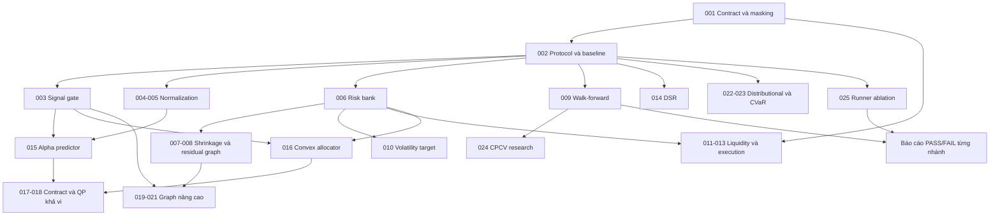

# Backlog cải thiện định lượng cho PPO + GNN

**Ngày lập:** 14/10/2026.  
**Phạm vi:** chia đề xuất trong tài liệu đính kèm thành công việc có thể triển khai và nghiệm thu trên repository hiện tại.  
**Trạng thái:** 25 ticket mới, chưa triển khai theo backlog này. Những phần đã tồn tại được ghi rõ để tái sử dụng.

Tài liệu này bổ sung cho [bảng điều phối hai người](BANG_DIEU_PHOI_2_NGUOI.md), [nhiệm vụ A](NHIEM_VU_THANH_VIEN_A.md) và [nhiệm vụ B](NHIEM_VU_THANH_VIEN_B.md). Cơ chế đang chạy được mô tả trong [LUONG_VA_CO_CHE_HE_THONG.md](LUONG_VA_CO_CHE_HE_THONG.md).

## 1. Mục tiêu và điểm xuất phát

Mục tiêu là kiểm tra xem nâng cấp có cải thiện **lợi suất ròng, rủi ro và tính ổn định ngoài mẫu** so với baseline phù hợp hay không. Nhãn “SOTA” trong đề xuất được xem là hướng nghiên cứu, không phải cam kết vượt 1/N.

| Thành phần | Hiện đã có | Công việc mới thực sự cần làm |
|---|---|---|
| Feature | 20 feature, gồm cross-sectional rank, excess return, beta SPY và momentum nhiều chân trời | Chuẩn hóa theo từng nhóm feature; đo tín hiệu qua nhiều giai đoạn |
| Lịch sử | GRU/LSTM và GNN + GRU; history mask tường minh | Nghiệm thu đường mask bằng chạy thực tế, giữ đúng contract khi thêm trạng thái |
| Graph | Ba quan hệ: tương quan dương, độ lớn tương quan âm, cùng ngành; kNN theo trị tuyệt đối | Shrinkage, residual graph; lead-lag và concept nodes là nhánh nâng cao |
| Actor | Dirichlet; có tổng concentration κ và khởi tạo gần đều | Alpha predictor và allocator riêng; thiết kế lại phương pháp học nếu dùng QP |
| Giao dịch | Timeline Close → Open kế tiếp → Close kế tiếp; explicit hold; phí/slippage cố định; cap từng mã | Thanh khoản, market impact, execution thích nghi và risk overlay |
| PPO | KL/critic diagnostics, microbatch, graph bank/cache, nhiều seed, metadata | DSR và critic phân vị phải có thiết kế loss, state và benchmark riêng |
| Đánh giá | Matched baseline, null policy, rank-IC, baseline tuyến tính, tilt robustness | Kế thừa script; thêm walk-forward, protocol đóng băng và ablation thống nhất |

Giai đoạn 2024–2025 đã được khảo sát nhiều lần. Các lần chạy trên đó tiếp tục được gắn nhãn **development/exploratory**. Holdout xác nhận phải là giai đoạn chưa dùng để chọn feature, cấu hình hoặc phương pháp; dữ liệu danh sách cổ phiếu cố định vẫn có hạn chế survivorship bias.

### Các điểm cần sửa trong cách hiểu đề xuất

- Ledoit–Wolf tuyến tính là điểm bắt đầu cho covariance; nonlinear shrinkage và lọc RMT là thử nghiệm riêng. Không đồng nhất ba phương pháp. [Bài gốc Ledoit–Wolf](https://www.ledoit.net/Well-conditioned2004.pdf).
- Covariance/correlation đầu vào cùng kỳ đối xứng; graph kNN hiện tại có thể có cạnh có hướng do chọn hàng xóm theo từng hàng. Lead-lag bổ sung ý nghĩa thời gian cho hướng cạnh.
- Không mặc định trị riêng lớn nhất luôn là thị trường. Residual graph phải so với cách hồi quy SPY; covariance dùng quản trị rủi ro vẫn phải giữ rủi ro thị trường.
- Square-root impact là mô hình tác động giá cần hiệu chỉnh; không dùng tên “Almgren–Chriss square-root” như hai mô hình đồng nhất. Đề xuất bắt đầu từ stress scenario vì dữ liệu daily không đủ xác nhận chất lượng khớp lệnh nội ngày. [Nghiên cứu square-root impact](https://journals.aps.org/prx/pdf/10.1103/PhysRevX.1.021006).
- Lớp tối ưu khả vi hỗ trợ đạo hàm qua nghiệm bài toán lồi. Việc ghép lớp đó vào PPO cần đặc tả action ngẫu nhiên và log-prob riêng; không giả định gradient xuyên QP tự động thay thế loss PPO. [Differentiable Convex Optimization Layers](https://arxiv.org/abs/1910.12430).
- Với long-only, không đòn bẩy và mọi beta cổ phiếu dương, beta tuyệt đối bằng 0 chỉ đạt được bằng toàn tiền mặt. Nếu cần beta neutrality, phải xác định **beta của trọng số chủ động so với benchmark**, hoặc mở rộng hợp đồng short/hedge trong một nghiên cứu riêng.
- DSR là mục tiêu khác reward hiện tại; critic phân vị là mô hình phân phối giá trị. Đổi reward hoặc số đầu ra critic không tự chứng minh tăng Sharpe/giảm drawdown. [Moody–Saffell](https://pubmed.ncbi.nlm.nih.gov/18249919/), [Quantile Regression Distributional RL](https://arxiv.org/abs/1710.10044).
- Cross-sectional normalization có thể bỏ mất thông tin mức rủi ro chung. Giữ thêm market context và kiểm chứng bằng ablation; không tuyên bố bất biến hoàn toàn với regime.
- Purge dựa trên thời gian mà label/rollout sử dụng; embargo được chọn theo protocol. Không đặt mặc định bằng lookback rồi coi mọi leakage đã được xử lý. History quá khứ chung ở ranh giới không tự nó là look-ahead.

## 2. Quy tắc phân công và nghiệm thu

- **A:** data, feature, covariance/risk, execution, reward, allocator và evaluation.
- **B:** graph, model, buffer/model contract, training loss, cache và runner.
- Owner chính triển khai khoảng 70%; người còn lại review, hiểu công thức và chạy lại một ví dụ khoảng 30%. Mỗi ticket có một owner để tránh không rõ trách nhiệm.
- **P0:** hoàn thành trước khi dùng kết quả mới để kết luận về lợi thế. **P1:** đợt nâng cấp thực dụng tiếp theo. **P2:** nghiên cứu có điều kiện, sau khi có bằng chứng hoặc nhu cầu rõ.
- Kiểm tra/benchmark trong DoD là việc của ticket khi được triển khai. Việc lập backlog không đồng nghĩa chúng đã chạy hoặc đã pass.
- Ticket có thể hoàn thành với kết quả **FAIL nghiên cứu** nếu implementation đúng và báo cáo đủ. Chỉ đưa thay đổi thành cấu hình mặc định khi qua gate đã đóng băng.
- H-MARL/sector agents trong kế hoạch gốc vẫn là luồng công việc riêng. QP khả vi, CPCV, concept nodes và distributional RL không phải điều kiện bắt buộc để hoàn thành phần core của đồ án.

### Gate dùng chung

1. Trước khi chạy, lưu ngày các fold, feature, horizon, hyperparameter search budget, seed, baseline, phí và ngưỡng chấp nhận vào config có hash.
2. Chọn hệ số và cấu hình bằng train/inner validation; outer validation dùng đánh giá. Không tự động đọc test ở mỗi thí nghiệm phát triển.
3. Báo cáo `sharpe_delta_vs_matched_baseline`, excess return ròng, turnover, chi phí, max drawdown, realized cash/exposure và thời gian chạy. So cả 1/N thuần và baseline có cùng cơ chế rủi ro/thực thi.
4. Mean/std qua seed đo biến động của thuật toán. Bootstrap theo block trên chuỗi excess return và kết quả theo fold đo bất định theo thời gian; báo cáo riêng hai loại.
5. Với mục tiêu tìm alpha, cần excess ròng dương qua nhiều fold, CI theo protocol và mức cải thiện tối thiểu đã chọn trước. Với mục tiêu giảm rủi ro, đặt gate rủi ro cùng giới hạn đánh đổi lợi suất; không gọi giảm exposure là alpha.
6. Gate tilt hiện có trong [tilt_robustness_gate.yaml](../configs/tilt_robustness_gate.yaml) vẫn giữ nguyên khi đánh giá đúng chiến lược đó: tối thiểu 3/4 giai đoạn dương, excess ròng năm ≥ 2%, CI lower > 0, mean Sharpe delta > 0 và drawdown degradation ≤ 0.02. Phương pháp khác có config gate riêng, đóng băng trước chạy.

## 3. Danh sách ticket

`Phụ thuộc` là công việc phải hoàn thành trước. Gate “có tín hiệu” áp dụng cho việc mở rộng mô hình dự báo alpha; các cải tiến đo lường và quản trị rủi ro vẫn có thể thực hiện khi alpha chưa được xác nhận.

| ID | Công việc | Ưu tiên | Owner / Review | Phụ thuộc |
|---|---|---|---|---|
| [QNT-001](#qnt-001) | Nghiệm thu contract hiện tại và history mask | P0 | B / A | — |
| [QNT-002](#qnt-002) | Đóng băng protocol, baseline và gate | P0 | A / B | QNT-001 |
| [QNT-003](#qnt-003) | Đo tín hiệu ngoài mẫu và baseline tuyến tính | P0 | A / B | QNT-002 |
| [QNT-004](#qnt-004) | Chuẩn hóa cross-sectional theo feature | P1 | A / B | QNT-002 |
| [QNT-005](#qnt-005) | Chuẩn hóa rolling causal, lưu state inference | P1 | A / B | QNT-004 |
| [QNT-006](#qnt-006) | Risk bank covariance EWMA/Ledoit–Wolf | P1 | A / B | QNT-001, QNT-002 |
| [QNT-007](#qnt-007) | Graph từ correlation sau shrinkage | P1 | B / A | QNT-006 |
| [QNT-008](#qnt-008) | Residual graph sau hồi quy SPY | P1 | B / A | QNT-007 |
| [QNT-009](#qnt-009) | Runner walk-forward causal | P1 | A / B | QNT-002 |
| [QNT-010](#qnt-010) | Volatility targeting cho policy và baseline | P1 | A / B | QNT-006, QNT-002 |
| [QNT-011](#qnt-011) | Thanh khoản ADV, volatility và data contract | P1 | A / B | QNT-001 |
| [QNT-012](#qnt-012) | Square-root impact và phân rã chi phí | P1 | A / B | QNT-011, QNT-002 |
| [QNT-013](#qnt-013) | Tốc độ execution thích nghi và vùng hold | P1 | A / B | QNT-012, QNT-006 |
| [QNT-014](#qnt-014) | Reward Differential Sharpe có state | P1 | A / B | QNT-001, QNT-002 |
| [QNT-015](#qnt-015) | Predictor alpha có supervision | P2 | B / A | QNT-003, QNT-004; gate tín hiệu |
| [QNT-016](#qnt-016) | Allocator lồi độc lập trước khi khả vi | P2 | A / B | QNT-006, QNT-003 |
| [QNT-017](#qnt-017) | Thiết kế contract Alpha → QP và loss học | P2 | B / A | QNT-015, QNT-016 |
| [QNT-018](#qnt-018) | Lớp QP khả vi và huấn luyện thử nghiệm | P2 | B / A | QNT-017 |
| [QNT-019](#qnt-019) | Lead-lag graph và số quan hệ linh hoạt | P2 | B / A | QNT-001, QNT-007, QNT-003; gate graph |
| [QNT-020](#qnt-020) | Spectral/RMT denoising, ablation riêng | P2 | B / A | QNT-006, QNT-007 |
| [QNT-021](#qnt-021) | Concept nodes và contract node/action | P2 | B / A | QNT-019; gate graph |
| [QNT-022](#qnt-022) | Critic phân vị và quantile loss | P2 | B / A | QNT-001, QNT-002 |
| [QNT-023](#qnt-023) | Mục tiêu actor CVaR và gate tail risk | P2 | A / B | QNT-022 |
| [QNT-024](#qnt-024) | CPCV có purge/embargo, research only | P2 | A / B | QNT-009 |
| [QNT-025](#qnt-025) | Runner ablation, năm seed và báo cáo quyết định | P1 | B / A | QNT-001, QNT-002; từng nhánh khi đánh giá |

## 4. Thứ tự thực hiện

| Đợt | Ticket | Đầu ra và điều kiện chuyển tiếp |
|---|---|---|
| **G0 — nền tảng** | 001 → 002 → 003; khởi tạo runner 025 | Contract được nghiệm thu; protocol cố định; biết feature nào có tín hiệu và baseline nào đang mạnh |
| **G1 — feature, risk, graph** | A: 004 → 005, 006, 009. B: 007 → 008, 025 | Ablation từng thay đổi trên validation/fold phát triển, giữ nguyên cấu hình còn lại |
| **G2 — risk và execution** | 010; 011 → 012 → 013; 014 riêng | Đo được tác động của risk overlay, impact và reward; không bật tất cả cùng lúc |
| **G3 — alpha và allocation** | 015 và 016 → 017 → 018 | Chỉ mở rộng khi alpha ngoài mẫu có tín hiệu và allocator thường đủ ổn định, đủ nhanh |
| **G4 — nghiên cứu nâng cao** | 019 → 021; 020; 022 → 023; 024 | Chọn nhánh theo bằng chứng. Không bắt buộc làm toàn bộ để hoàn thành dự án |

Gợi ý bắt đầu: **A làm QNT-002/003 sau nghiệm thu; B làm QNT-001 rồi QNT-025.** Sau đó A bàn giao covariance từ QNT-006 để B làm QNT-007. Các mã rút gọn trong sơ đồ là số của ticket `QNT-*`; bảng phụ thuộc phía trên là nguồn chính xác.

## 5. Ticket chi tiết

Đường dẫn có link là file đang tồn tại. Đường dẫn ghi **dự kiến** là đề xuất khi triển khai, không phải file đã tạo.

### QNT-001 — Nghiệm thu contract và history mask

- [ ] **P0 · Owner B · Review A**
- **Đầu vào:** nguồn hiện có đã truyền `history_mask` qua env, adapter, buffer và model.
- **Phạm vi:** kiểm tra GRU/LSTM/GNN với all-valid, left padding, ngày thật có feature bằng 0 và all-invalid; kiểm tra cache/microbatch/buffer cùng dùng mask. Lưu schema version cho observation, graph, model và checkpoint.
- **File:** [actor_critic.py](../src/models/actor_critic.py), [policy_adapter.py](../src/models/policy_adapter.py), [market_cache.py](../src/models/market_cache.py), [ppo_core.py](../src/training/ppo_core.py), [trading_env.py](../src/env/trading_env.py).
- **DoD:** hidden của chuỗi có padding khớp chuỗi thật trong tolerance đã nêu; `act/evaluate` có log-prob nhất quán trước update; gradient hữu hạn; cache và đường uncached khớp; legacy checkpoint có hành vi rõ. Masking không chỉ được đánh dấu hoàn thành bằng compile.
- **Bàn giao:** báo cáo regression, schema hiện tại và cấu hình nhỏ cố định cho các ablation tiếp theo.

### QNT-002 — Đóng băng protocol, baseline và gate

- [ ] **P0 · Owner A · Review B · Phụ thuộc QNT-001**
- **Phạm vi:** tạo config thí nghiệm gồm train/inner-val/outer-val, seed, search budget, checkpoint rule và gate. Thêm chế độ đánh giá validation/fold phát triển mà không tự chạy test; tên CLI chốt khi triển khai.
- **File:** [train_ppo.py](../src/training/train_ppo.py), [metrics.py](../src/evaluation/metrics.py), [artifacts.py](../src/utils/artifacts.py); config **dự kiến** `configs/quant_research_protocol.yaml`.
- **DoD:** baseline 1/N, matched cash + alpha và untrained policy có cùng timeline/cost/cap; lịch tái cân bằng và first allocation được ghi rõ. Khi thêm overlay, baseline áp dụng cùng quy tắc causal; không lấy cash/exposure nhìn lại từ PPO để tối ưu baseline.
- **Checkpoint:** lưu cả mức cải thiện so epoch 0 và matched baseline; trường hợp không đạt margin đã định báo “chưa đạt gate”, không trình bày fallback như kết quả đã học.
- **Bàn giao:** config có hash, baseline reference mới sau masking, bảng protocol và giới hạn holdout. Tiêu chí giảm rủi ro và tìm alpha được xác định trước theo mục tiêu của nhánh.

### QNT-003 — Đo tín hiệu ngoài mẫu và baseline tuyến tính

- [ ] **P0 · Owner A · Review B · Phụ thuộc QNT-002**
- **Đã có:** script rank-IC, train-fitted linear tilt, null và tilt robustness. Mở rộng đánh giá, không viết lại từ đầu.
- **Phạm vi:** rank-IC ở horizon 1/5/20 trên label thực thi được; hệ số, hướng tín hiệu và strength fit trên train/inner-val. Đánh giá riêng từng outer fold/giai đoạn phát triển, gồm 1/N lõi + tilt và matched baseline.
- **File:** [analyze_feature_signal.py](../scripts/analyze_feature_signal.py), [evaluate_equal_weight_tilt.py](../scripts/evaluate_equal_weight_tilt.py), [evaluate_tilt_robustness.py](../scripts/evaluate_tilt_robustness.py).
- **DoD:** purge các label train kéo vào kỳ đánh giá; IC có số mẫu và block CI; báo cáo turnover/cost, spread lợi suất giữa các nhóm score và độ ổn định dấu IC. Tham số không được chọn bằng outer fold/test.
- **Bàn giao:** `signal_by_fold.csv`, `linear_baseline_by_fold.csv` và quyết định **GO/NO-GO alpha modeling**. IC dương đơn lẻ chưa đủ thay cho lợi thế danh mục ròng; kết quả âm vẫn hoàn thành ticket.

### QNT-004 — Chuẩn hóa cross-sectional theo feature

- [ ] **P1 · Owner A · Review B · Phụ thuộc QNT-002**
- **Phạm vi:** thêm chế độ `static_train`, `xs_zscore`, `xs_rank` và tùy chọn gaussian rank. Cấu hình theo tên feature; feature vốn là rank/RSI hữu hạn không tự động chuẩn hóa lần nữa.
- **File:** [scaler.py](../src/features/scaler.py), [pipeline.py](../src/features/pipeline.py), [relative.py](../src/features/relative.py), [policy_adapter.py](../src/models/policy_adapter.py); module **dự kiến** `src/features/normalization.py`.
- **DoD:** ngày t chỉ dùng các mã thuộc universe hợp lệ ngày t; ticker order không đổi; xử lý ties, N=1, std=0 và thiếu dữ liệu; gaussian quantile có plotting position hữu hạn. Padding giữ bằng 0 sau transform và dùng mask tường minh.
- **Bàn giao:** metadata mode/feature/clip/epsilon, batch–stream parity, ablation với scaler hiện tại. Giữ market-level volatility/beta/liquidity context khi rank làm mất mức tuyệt đối.

### QNT-005 — Causal rolling normalization và state inference

- [ ] **P1 · Owner A · Review B · Phụ thuộc QNT-004**
- **Phạm vi:** rolling z-score theo từng mã/feature, cửa sổ ban đầu 252 phiên; chốt `statistics[t-252:t)` để chuẩn hóa feature t. Các horizon khác chỉ chọn trong inner-val.
- **File:** [scaler.py](../src/features/scaler.py), [policy_adapter.py](../src/models/policy_adapter.py), [data_types.py](../src/utils/data_types.py), [train_ppo.py](../src/training/train_ppo.py).
- **DoD:** sửa dữ liệu sau t không đổi normalized feature t; batch và inference từng ngày khớp; không fit cả val/test một lần. Lưu rolling state, ngày cuối, ticker/feature order, warm-up và readiness riêng với history mask.
- **Bàn giao:** checkpoint/resume/walk-forward khôi phục đúng state; tỷ lệ clip/outlier theo fold và ablation static vs xs vs rolling vs hybrid.

### QNT-006 — Risk bank covariance EWMA/Ledoit–Wolf

- [ ] **P1 · Owner A · Review B · Phụ thuộc QNT-001, QNT-002**
- **Phạm vi:** một bộ ước lượng covariance causal theo ngày dùng chung cho graph, risk overlay và allocator; baseline sample covariance, EWMA và Ledoit–Wolf tuyến tính.
- **File:** [risk.py](../src/env/risk.py), [correlation.py](../src/graph/correlation.py), [data_types.py](../src/utils/data_types.py); module **dự kiến** `src/risk/covariance.py`.
- **Contract:** `covariance[T,N,N]`, ordered tickers/dates, return basis, đơn vị daily, sample count/readiness, estimator/window/decay và shrinkage metadata. Cash được thêm với variance/covariance bằng 0 ở consumer khi cần.
- **DoD:** shape N=1 đúng; dữ liệu hữu hạn, ma trận đối xứng và PSD trong tolerance; shrinkage/fallback/jitter được log. Dữ liệu sau t không ảnh hưởng covariance t; annualization chỉ thực hiện một lần.
- **Bàn giao:** covariance bank cache theo data/config hash, condition number, eigenvalue minimum và sai số dự báo volatility ngoài mẫu. Rủi ro toàn danh mục dùng covariance lợi suất đầy đủ, không thay bằng covariance residual.

### QNT-007 — Graph từ correlation sau shrinkage

- [ ] **P1 · Owner B · Review A · Phụ thuộc QNT-006**
- **Phạm vi:** chuyển covariance đã shrink thành correlation rồi dựng graph; giữ ba quan hệ và kNN theo `abs(corr)`. Sample Pearson vẫn là đối chứng.
- **File:** [dynamic_graph.py](../src/graph/dynamic_graph.py), [multi_relation_graph.py](../src/graph/multi_relation_graph.py), [builder.py](../src/graph/builder.py), [train_ppo.py](../src/training/train_ppo.py).
- **DoD:** diagonal chuẩn hóa đúng và xử lý variance=0; bỏ self-edge động theo contract; k không vượt N−1; dấu/độ mạnh cạnh đi đúng kênh; live/matrix API và batch sequence nhất quán.
- **Bàn giao:** edge count từng quan hệ, tỷ lệ cạnh thay đổi từng ngày, connected components và ablation Pearson vs shrinkage với cùng model/seed/feature/cost. Graph mượt hơn chưa được tính là bằng chứng alpha.

### QNT-008 — Residual graph sau hồi quy SPY

- [ ] **P1 · Owner B · Review A · Phụ thuộc QNT-007**
- **Phạm vi:** hồi quy causal từng cổ phiếu theo SPY trên cửa sổ trailing; dựng correlation của residual. Chốt rõ cách tính beta và residual trong cửa sổ tại t; SPY tiếp tục là benchmark, không thêm vào action.
- **File:** [relative.py](../src/features/relative.py), [correlation.py](../src/graph/correlation.py), [dynamic_graph.py](../src/graph/dynamic_graph.py), [multi_relation_graph.py](../src/graph/multi_relation_graph.py).
- **DoD:** ticker/date/return basis khớp; không fit beta trên cả giai đoạn tương lai; beta/residual hữu hạn, missing-SPY có lỗi/fallback được cấu hình và ghi nhận. Risk bank đầy đủ từ QNT-006 không bị ghi đè.
- **Bàn giao:** so raw graph vs residual graph; phân tích market exposure và mức đóng góp graph so GRU. Fama–French là mở rộng khi có dữ liệu và lịch công bố phù hợp; loại top eigenmode thuộc QNT-020.

### QNT-009 — Runner walk-forward causal

- [ ] **P1 · Owner A · Review B · Phụ thuộc QNT-002**
- **Phạm vi:** rolling/expanding folds; retrain hoặc fine-tune mỗi 20/60 phiên là ứng viên cấu hình. Mỗi fit chỉ nhận dữ liệu có sẵn trước ngày deployment; scaler và checkpoint selection thuộc phần train/inner-val của fold.
- **File:** [split.py](../src/data/split.py), [train_ppo.py](../src/training/train_ppo.py), [backtester.py](../src/evaluation/backtester.py), [artifacts.py](../src/utils/artifacts.py); script **dự kiến** `scripts/evaluate_walk_forward.py`.
- **DoD:** label/rollout overlap được purge; model triển khai chỉ chạy sau thời điểm fit; nối OOS daily returns không trùng/ngắt ngày. NAV, holdings, cash và phí tiếp tục qua điểm retrain, không reset danh mục miễn phí ở mỗi fold.
- **Bàn giao:** manifest theo fold chứa fit/deploy dates, parent checkpoint/scaler state, fresh-train vs fine-tune, runtime và artifact. Cache bị invalid khi model/scaler đổi; baseline chạy liên tục trên cùng lịch.

### QNT-010 — Volatility targeting cho policy và baseline

- [ ] **P1 · Owner A · Review B · Phụ thuộc QNT-006, QNT-002**
- **Phạm vi:** risk overlay causal với `k=min(1, target_vol/forecast_vol)`; giảm phần cổ phiếu theo k, chuyển phần còn lại vào cash. Target và forecast dùng cùng đơn vị annualized hoặc daily đã khai báo.
- **File:** [risk.py](../src/env/risk.py), [rebalance.py](../src/env/rebalance.py), [orders.py](../src/env/orders.py), [trading_env.py](../src/env/trading_env.py), [baselines/](../src/evaluation/baselines/).
- **DoD:** forecast từ covariance t; cash/zero variance an toàn, không đòn bẩy; weights tổng 1 và cap hợp lệ; thay đổi overlay dẫn đến giao dịch thì tính phí đúng. Explicit hold giữ nguyên cổ phiếu nếu không có lịch/lệnh risk override đã khai báo.
- **Bàn giao:** realized vol, target tracking, cash/exposure, return và tail loss. So 1/N dùng cùng overlay, estimator và lịch; đánh giá mục tiêu giảm rủi ro theo gate riêng, không suy ra alpha từ Sharpe tăng do cash.

### QNT-011 — Thanh khoản ADV, volatility và data contract

- [ ] **P1 · Owner A · Review B · Phụ thuộc QNT-001**
- **Phạm vi:** trailing **dollar ADV** và daily volatility theo từng mã; stats để quyết định ở Close[t] chỉ dùng dữ liệu đến t.
- **File:** [pipeline.py](../src/features/pipeline.py), [alignment.py](../src/data/alignment.py), [data_types.py](../src/utils/data_types.py); module **dự kiến** `src/features/liquidity.py`.
- **DoD:** đơn vị ADV là tiền/ngày, volatility là tỷ lệ/ngày. Chốt giá/volume adjustment basis; không nhân giá total-return đã điều chỉnh cổ tức với volume rồi mặc định đó là notional giao dịch thật. Xử lý zero volume, thiếu dữ liệu, split và ticker order.
- **Bàn giao:** liquidity bank theo ngày, metadata source/window/readiness và prefix invariance. Volume thực tế của ngày t+1 không được dùng để chọn lệnh tại t.

### QNT-012 — Square-root impact và phân rã chi phí

- [ ] **P1 · Owner A · Review B · Phụ thuộc QNT-011, QNT-002**
- **Phạm vi:** optional impact trên commission/spread baseline; `impact_rate_i = eta * sigma_i * sqrt(Q_i / dollar_ADV_i)`, `impact_cost = sum(Q_i * impact_rate_i)` với Q là notional giao dịch thực tế tại Open kế tiếp.
- **File:** [cost.py](../src/env/cost.py), [trading_env.py](../src/env/trading_env.py), [metrics.py](../src/evaluation/metrics.py), [env.yaml](../configs/env.yaml).
- **DoD:** stock legs chỉ tính một lần, cash leg không tạo impact; hold/zero trade có phí 0; `eta=0` khớp đường hiện tại; dữ liệu thanh khoản forecast causal; tổng chi phí tiền khớp NAV. Log riêng commission, spread/slippage và impact, không tính trùng.
- **Bàn giao:** stress theo eta và NAV, cost decomposition và cảnh báo participation khi thiếu dữ liệu. Nếu không có execution data để hiệu chỉnh eta, báo rõ là scenario; với NAV 100k và cổ phiếu thanh khoản cao có thể tác động nhỏ.

### QNT-013 — Execution thích nghi và vùng hold

- [ ] **P1 · Owner A · Review B · Phụ thuộc QNT-012, QNT-006**
- **Phạm vi:** tốc độ từng mã dựa trên chi phí/thanh khoản/rủi ro causal; no-trade band và participation cap. Bắt đầu diagonal speed có ràng buộc trước khi nghiên cứu ma trận Ω đầy đủ.
- **File:** [orders.py](../src/env/orders.py), [rebalance.py](../src/env/rebalance.py), [trading_env.py](../src/env/trading_env.py), [policy_adapter.py](../src/models/policy_adapter.py).
- **DoD:** target được chốt từ Close, execution cost dùng drift tại Open; không đọc Open tương lai để chọn tốc độ tại Close. Sau tốc độ từng mã, weights/cash/cap vẫn hợp lệ; hold bỏ rebalance. Blend không bị áp dụng hai lần.
- **Bàn giao:** các baseline cùng execution controller, tỷ lệ hold, turnover, chi phí và signal decay. Nghịch đảo volatility chỉ là một heuristic để ablation; tốc độ Gârleanu–Pedersen cần giả định về cost và decay, không suy ra chỉ từ một công thức `alpha_i`. [Bài Gârleanu–Pedersen](https://www.nber.org/papers/w15205).

### QNT-014 — Reward Differential Sharpe có state

- [ ] **P1 · Owner A · Review B · Phụ thuộc QNT-001, QNT-002**
- **Phạm vi:** reward mode riêng cho DSR; trước cập nhật EMA, dùng A/B của bước trước và delta từ return ròng hiện tại. Chốt rõ net excess so risk-free hay active return so benchmark; hai mục tiêu có benchmark khác nhau.
- **File:** [reward.py](../src/env/reward.py), [trading_env.py](../src/env/trading_env.py), [ppo_core.py](../src/training/ppo_core.py), [policy_adapter.py](../src/models/policy_adapter.py), [train_ppo.py](../src/training/train_ppo.py).
- **DoD:** denominator có epsilon/warm-up; constant-return và variance rất nhỏ không gây reward nổ/NaN. EMA moments, readiness và update convention có state trong observation/reset/checkpoint; bootstrapping tại cửa sổ dùng trạng thái đúng. Không khởi tạo moments bằng lợi suất policy từ tương lai.
- **Bàn giao:** reward scale/clipping diagnostics, gradient/KL/EV; ablation excess-return vs DSR với seed/fold cố định. Selection metric ăn khớp mục tiêu đã khai báo; không vừa đổi reward, graph và gamma trong cùng một đối chứng.

### QNT-015 — Predictor alpha có supervision

- [ ] **P2 · Owner B · Review A · Phụ thuộc QNT-003, QNT-004; cần gate tín hiệu**
- **Phạm vi:** GRU trước, GNN + GRU sau; head xuất `alpha_hat[N]`, không trực tiếp tạo weights. Baseline ridge từ script hiện tại là đối chứng tối thiểu.
- **File:** [actor_critic.py](../src/models/actor_critic.py), [adapters.py](../src/models/adapters.py), [analyze_feature_signal.py](../scripts/analyze_feature_signal.py); module/script **dự kiến** `src/models/alpha_predictor.py`, `scripts/train_alpha_predictor.py`.
- **DoD:** chốt label next-Open → Close tại horizon 1/5/20 và benchmark tương đối; label train kết thúc trước outer-val; loss MSE/rank được chọn trong inner-val. Nếu dùng rank score trong allocator, phải hiệu chỉnh thành đơn vị expected return từ train.
- **Bàn giao:** IC/calibration/turnover theo fold; vector alpha và horizon/basis metadata có batch–inference parity. Gate phải so ridge/tilt và 1/N ròng; không chỉ dựa train loss hoặc IC.

### QNT-016 — Allocator lồi độc lập

- [ ] **P2 · Owner A · Review B · Phụ thuộc QNT-006, QNT-003**
- **Phạm vi:** allocator thường trước QP khả vi; nhận alpha từ ridge/train-only hoặc QNT-015, covariance, danh mục tại Close và cost coefficients. Hạn chế deviation so danh mục lõi 1/N là tùy chọn.
- **File:** [rebalance.py](../src/env/rebalance.py), [risk.py](../src/env/risk.py), [backtester.py](../src/evaluation/backtester.py); package **dự kiến** `src/allocation/`.
- **Bài toán:** maximize `alpha·w − risk_aversion/2 * wᵀΣw − turnover_penalty/2 * ΔwᵀΛΔw`; optional L1 penalty qua biến phụ. Sigma/Λ PSD, alpha/covariance cùng horizon/đơn vị. Phí thực tế vẫn tính trong env, penalty tối ưu không được cộng vào NAV như phí lần nữa.
- **Ràng buộc:** simplex/cash, long-only, max asset, sector caps; tracking-error cap làm bài toán quadratic-constrained/SOCP, không còn QP thuần. Beta constraint phải chỉ rõ active beta so benchmark và kiểm tra khả thi.
- **DoD:** synthetic feasible/infeasible/ill-conditioned cases; sum/cap/constraint residual trong tolerance; solver timeout/failure fallback được log. `w_prev` là trạng thái biết tại Close; không dùng Open[t+1] drift như thông tin ra quyết định.
- **Bàn giao:** runtime/solver status, mean-variance baseline và alpha + allocator vs alpha + đơn giản tilt, cùng execution/cost. Chốt allocator đã penalize turnover có còn cần alpha blend hay không bằng đối chứng rõ.

### QNT-017 — Contract Alpha → QP và phương pháp học

- [ ] **P2 · Owner B · Review A · Phụ thuộc QNT-015, QNT-016**
- **Phạm vi:** tài liệu thiết kế trước khi nối loss: chọn supervised alpha + fixed allocator, differentiable utility training hoặc policy-gradient trên latent action alpha. Mỗi nhánh có trainer/metadata riêng.
- **File:** [actor_critic.py](../src/models/actor_critic.py), [ppo_core.py](../src/training/ppo_core.py), [adapters.py](../src/models/adapters.py), [policy_adapter.py](../src/models/policy_adapter.py); tài liệu **dự kiến** `manual/THIET_KE_ALPHA_QP.md`.
- **DoD:** định nghĩa action space, distribution, log-prob, deterministic evaluation và buffer rõ. Nếu PPO sample alpha, ratio dùng log-prob của alpha đã sample; không evaluate QP weights dưới Dirichlet. Nếu học utility qua solver, xác định differentiable training simulator/loss và horizon; không gọi đó là PPO loss mặc định.
- **Bàn giao:** schema/version, train/live parity, giá trị nào cần grad, cost/risk nào là forecast và phần nào là realized. Bản thiết kế được cả A/B nghiệm thu trước QNT-018.

### QNT-018 — Lớp QP khả vi

- [ ] **P2 · Owner B · Review A · Phụ thuộc QNT-017**
- **Phạm vi:** thêm backend `cvxpylayers` hoặc solver khả vi được chọn theo thiết kế; đối chiếu nghiệm với QNT-016. Giữ backend allocator thường để debug/fallback.
- **File:** package `src/allocation/` **dự kiến**, [actor_critic.py](../src/models/actor_critic.py), [train_ppo.py](../src/training/train_ppo.py), [pyproject.toml](../pyproject.toml).
- **DoD:** pin phiên bản solver/library và kiểm tra DPP theo phiên bản chọn; covariance có parameterization PSD rõ. Gradient hữu hạn và đối chiếu finite difference trên miền phù hợp; boundary/nonunique solutions và fallback có chính sách rõ, không giả gradient qua solver failure.
- **Bàn giao:** benchmark CPU/GPU/batch/time-memory trong budget đã chốt, nghiệm/gradient report và experiment so fixed allocator. Lớp khả vi chỉ được tiếp tục nếu overhead và gate cải thiện đạt yêu cầu. [CVXPYlayers chính thức](https://github.com/cvxpy/cvxpylayers).

### QNT-019 — Lead-lag graph, số quan hệ linh hoạt

- [ ] **P2 · Owner B · Review A · Phụ thuộc QNT-001, QNT-007, QNT-003; cần gate graph**
- **Phạm vi:** thêm `Corr(r_i,s−lag, r_j,s)` trên các s ≤ t với lag ứng viên 1/2/5. Quy ước source i → target j nhất quán với message passing; không giải thích correlation như quan hệ nhân quả đã chứng minh.
- **File:** [dynamic_graph.py](../src/graph/dynamic_graph.py), [multi_relation_graph.py](../src/graph/multi_relation_graph.py), [actor_critic.py](../src/models/actor_critic.py), [ppo_core.py](../src/training/ppo_core.py), [market_cache.py](../src/models/market_cache.py), [policy_adapter.py](../src/models/policy_adapter.py).
- **DoD:** prefix invariance; số mẫu effective sau lag đúng; kiểm tra toy lead/lag để phát hiện đảo hướng. Relation names/count đi xuyên graph bank `[T,R,N,N]`, buffer, model, cache, checkpoint và live; không hard-code R=3 ở consumer.
- **Bàn giao:** edge/sign/stability statistics; một lag hoặc nhóm lag theo budget đã đóng băng. Chỉ mở rộng khi graph hiện tại có đóng góp ngoài mẫu so GRU/sector-only hoặc khi ablation này được duyệt là nghiên cứu riêng.

### QNT-020 — Spectral/RMT denoising

- [ ] **P2 · Owner B · Review A · Phụ thuộc QNT-006, QNT-007**
- **Phạm vi:** thử eigenvalue clipping/shrinkage trong spectral noise band; kiểm chứng giả định và N/T hiệu dụng. So Ledoit–Wolf trước; nonlinear shrinkage là backend riêng nếu chọn, không thay tên estimator tuyến tính.
- **File:** [correlation.py](../src/graph/correlation.py), [dynamic_graph.py](../src/graph/dynamic_graph.py); module **dự kiến** `src/graph/denoising.py`.
- **DoD:** reconstruction đối xứng/PSD, diagonal/trace convention rõ; λ band và số eigenmodes giữ được log. Nếu thử loại top mode, đo liên hệ mode đó với SPY và chuẩn hóa residual correlation lại; không tự động coi đó là market factor.
- **Bàn giao:** eigen spectrum, edge stability, raw vs LW vs RMT vs SPY-residual ablation; graph residual không thay thế covariance tổng rủi ro.

### QNT-021 — Concept nodes và node/action mapping

- [ ] **P2 · Owner B · Review A · Phụ thuộc QNT-019; cần gate graph**
- **Phạm vi:** thêm K latent concept/sector nodes từ feature và attention causal; starts K nhỏ, chọn trong inner-val. Làm thiết kế tối thiểu trước heterogeneous graph đầy đủ.
- **File:** [actor_critic.py](../src/models/actor_critic.py), [multi_relation_graph.py](../src/graph/multi_relation_graph.py), [adapters.py](../src/models/adapters.py); module **dự kiến** `src/models/gnn/concept_encoder.py`.
- **DoD:** phân biệt `n_graph_nodes=N+K` với `n_tradable_assets=N`; action vẫn N+1 gồm cash. Buffer/cache/edge masks/node type/checkpoint giữ mapping; concept học trong train, không tổng hợp future/outer-val toàn kỳ.
- **Bàn giao:** ablation sector-only, learned concepts, randomized/no-concept control; attention/concept stability và overhead. Đồng bộ với các `ADV-GRAPH-*` cũ để tránh hai implementation trùng nhau.

### QNT-022 — Critic phân vị và quantile loss

- [ ] **P2 · Owner B · Review A · Phụ thuộc QNT-001, QNT-002**
- **Phạm vi:** optional critic M quantiles, quantile Huber loss và bootstrap targets được đặc tả; actor trước mắt vẫn tối ưu expectation để tách tác động critic khỏi thay mục tiêu.
- **File:** [actor_critic.py](../src/models/actor_critic.py), [ppo_core.py](../src/training/ppo_core.py), [logger.py](../src/training/logger.py), [train_ppo.py](../src/training/train_ppo.py).
- **DoD:** scalar value dùng GAE/EV là mean quantiles theo quy ước rõ; distributional target không bị thay bằng scalar TD target mà vẫn tuyên bố học đủ phân phối. Quantile crossing, calibration, coverage và loss được log; checkpoint ghi grid τ/M/basis.
- **Bàn giao:** scalar critic vs quantile critic, cùng actor/reward và budget. QR-DQN/IQN papers là cơ sở tham khảo; việc chuyển sang PPO cần thiết kế on-policy targets riêng.

### QNT-023 — Actor CVaR và gate tail risk

- [ ] **P2 · Owner A · Review B · Phụ thuộc QNT-022**
- **Phạm vi:** định nghĩa CVaR của loss hay lower-tail return, horizon, tail level và mục tiêu actor; quy tắc risk-sensitive advantage hoặc constrained update được thiết kế rõ.
- **File:** [ppo_core.py](../src/training/ppo_core.py), [reward.py](../src/env/reward.py), [metrics.py](../src/evaluation/metrics.py), [train_ppo.py](../src/training/train_ppo.py).
- **DoD:** không chỉ thay critic bằng quantiles rồi giữ actor loss cũ và gọi CVaR tối ưu. Với 32 quantiles, tail 5% chỉ tương ứng khoảng 1–2 điểm; chọn grid/tail integration và budget 64/128 hoặc tail-focused phù hợp trước thí nghiệm.
- **Bàn giao:** realized tail loss/CVaR, drawdown, net return, cash và risk-matched baseline theo fold; gate giới hạn đánh đổi lợi suất. Không suy ra drawdown chắc chắn giảm từ công thức CVaR.

### QNT-024 — CPCV research, purge và embargo

- [ ] **P2 · Owner A · Review B · Phụ thuộc QNT-009**
- **Phạm vi:** split combinatorial cho nghiên cứu; mỗi sample có decision time, label interval và rollout interval nếu liên quan. Fit scaler/hyperparameter trên train fold theo protocol.
- **File:** [split.py](../src/data/split.py), [analyze_feature_signal.py](../scripts/analyze_feature_signal.py); module **dự kiến** `src/evaluation/purged_cv.py`.
- **DoD:** purge overlap theo interval thực tế; embargo được cấu hình/giải thích, không tự động bằng lookback. Giới hạn tổ hợp, log membership và bootstrap theo dependence; tránh episode nối qua nhóm đánh giá.
- **Bàn giao:** split visualization, overlap checks và CPCV research report. Nếu train có nhóm ở tương lai so nhóm đánh giá, ghi rõ không mô phỏng deployment causal; walk-forward QNT-009 vẫn là phép đánh giá chính cho chạy theo thời gian.

### QNT-025 — Runner ablation, năm seed và báo cáo quyết định

- [ ] **P1 · Owner B · Review A · Phụ thuộc QNT-001, QNT-002; nhánh nào triển khai xong mới đánh giá nhánh đó**
- **Đã có:** `--seeds`, tổng hợp cột số và metadata riêng; immutable artifacts, progress, microbatch và graph cache. Kế thừa các cơ chế này.
- **Phạm vi:** runner thống nhất config/fold/seed `7,17,27,37,47`, resource budget, resume, stage gates và bảng ablation. Runner có thể xây sớm; báo cáo cập nhật khi từng ticket xong.
- **File:** [train_ppo.py](../src/training/train_ppo.py), [seed_summary.py](../src/evaluation/seed_summary.py), [artifacts.py](../src/utils/artifacts.py), [LENH_CHAY.md](LENH_CHAY.md); script **dự kiến** `scripts/run_quant_ablations.py`.
- **DoD:** mỗi run có data/source/config hash, fold/seed, checkpoint status/epoch, baseline ID, normalization/risk/graph/reward/solver schema và elapsed time. Tổng hợp numeric tách metadata; giữ kết quả seed thất bại/NO-GO, không chỉ các seed thắng.
- **Bàn giao:** long-form per-fold/seed CSV, mean/std, paired block CI và quyết định retain/reject/needs-data. Không coi năm seed là năm giai đoạn thị trường độc lập; báo lại số cấu hình đã khảo sát.

## 6. Ma trận thí nghiệm tối thiểu

| Câu hỏi | Đối chứng | Thay đổi duy nhất trong vòng đầu |
|---|---|---|
| Chuẩn hóa có giúp không? | Static train scaler | XS hoặc rolling; model/cost/seed giữ nguyên |
| Graph có thêm tín hiệu không? | GRU, graph sector-only và graph hiện tại | LW rồi SPY residual; cùng feature và capacity/budget được ghi rõ |
| Risk overlay làm được gì? | PPO và 1/N không overlay | Cùng volatility-target rule trên cả hai |
| Execution có giảm cost không? | Scalar alpha, linear costs | Adaptive speed; báo riêng constant-cost và impact-cost scenarios |
| DSR có giúp objective không? | Excess-return reward | DSR với EMA/state/scale đã chốt; graph và gamma giữ nguyên |
| QP có đóng góp không? | Cùng alpha predictor + simple tilt | Fixed convex allocator trước, differentiable allocator sau |
| Tail-risk objective có giúp không? | Scalar critic và expectation actor | Quantile critic trước; CVaR actor ở thí nghiệm kế tiếp |
| Retrain có giúp không? | Frozen model trên cùng các OOS ngày | Walk-forward với cost/state continuity |

Mỗi đối chứng được đánh giá trên protocol QNT-002, chạy nhỏ trước để ước lượng runtime rồi chạy đủ budget đã chốt. Một cấu hình tổ hợp chỉ được thử sau khi biết tác động riêng của thành phần; kết quả tổ hợp cũng phải qua gate, vì hiệu quả không mặc định cộng được.

## 7. Quan hệ với ticket cũ và quản lý trạng thái

| Ticket mới | Ticket cũ liên quan | Cách quản lý |
|---|---|---|
| 001 | MODEL-001, BASE-004, TRAIN-001, LEAK-001/002 | Nghiệm thu phiên bản contract/masking hiện tại |
| 003–005 | FEAT-006, SPLIT-002, EXP-006 | Kế thừa feature/signal scripts; không tạo lại 20 feature |
| 006–008, 019–021 | GRAPH-001/004/005/006, GNN-004, ADV-GRAPH-* | Mở rộng graph ba quan hệ đã nối vào model |
| 009, 024 | SPLIT-001, RESEARCH-002 | Protocol nghiên cứu bổ sung, giữ holdout caveat |
| 010–014 | ENV-004/006/007/009, EXP-009 | Thêm mode có config và baseline, giữ contract execution |
| 015–018, 022–023 | BASE-004, MODEL-001, DOC-002 | Nhánh phương pháp mới; checkpoint/trainer version riêng |
| 025 | EXP-002/003/004/005, RESEARCH-001/003 | Dùng chung runner/artifacts, đồng bộ kết quả về kế hoạch gốc |

**Nguồn trạng thái ticket QNT:** checklist ở mục 5 trong tài liệu này. Danh sách trong file A/B là phân công và đường dẫn, tránh ghi trạng thái hoàn thành ở nhiều chỗ.

Khi đóng ticket, bổ sung: commit/source hash, command/config, artifact path, kết quả DoD, kết quả gate PASS/FAIL và người review. Ngưỡng được thay đổi cho vòng nghiên cứu mới phải có version mới trước chạy, cùng lịch sử lý do; không sửa gate cũ để hợp thức hóa kết quả.
